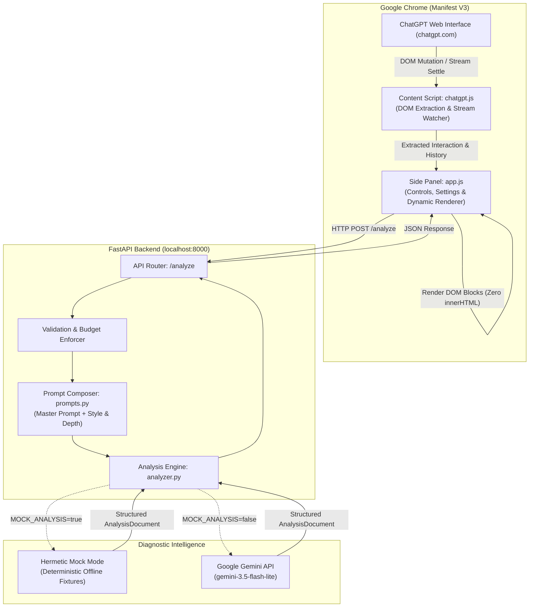

# Why Did AI Do That? (WDAIDT)

> **Ever wonder why ChatGPT answered your prompt the way it did?**  
> WDAIDT is a browser extension that lives in your Chrome side panel, providing real-time, evidence-based diagnostic explanations and ready-to-use follow-up prompts for your ChatGPT conversations.

[Repository](https://github.com/castlekrishna/WDAIDT) · [Submission Audit](docs/SUBMISSION_READINESS.md) · [Changelog](docs/CHANGELOG.md) · [Release Notes (V1.0.0)](docs/V1.0.0.md)

---

## About the Project

When working with ChatGPT, developers, researchers, and creators frequently encounter responses that take unexpected architectural paths, omit critical constraints, make unstated assumptions, or misunderstand the broader goal. Until now, figuring out *why* meant guessing, re-reading massive blocks of text, or entering tedious back-and-forth prompt debates.

**Why Did AI Do That? (WDAIDT)** gives you instant diagnostic X-ray vision directly in your browser sidebar. It captures completed ChatGPT exchanges, evaluates what visible evidence and constraints shaped the AI's reply, and presents clean, structured explanations accompanied by concrete, copyable next prompts.

### Epistemic Boundary

WDAIDT offers interpretations grounded strictly in visible conversation evidence. It evaluates what instructions were present, what trade-offs were skipped, and how phrasing shaped the outcome.

> [!NOTE]
> WDAIDT does not access hidden model weights, private internal activations, or private chains of thought. Explanations use hedged, epistemically honest phrasing (*"The response appears to...", "Seems to prioritize..."*) rather than asserting unobservable facts about the model's internal calculations.

---

## What the Project Does (What You Can Do With It)

WDAIDT transforms ChatGPT into a transparent, debuggable AI workspace:

- **Instant One-Click Diagnosis ("Why?")**: Click the **Why?** button at any point in your chat to instantly analyze the latest exchange. See what constraints were honored, what trade-offs were omitted, and what assumptions were made.
- **Auto-Pilot Analysis**: Toggle the **Auto** switch to `ON`, and WDAIDT automatically diagnoses new replies the moment ChatGPT finishes generating text.
- **Actionable Follow-Up Prompts**: Stop wondering what to ask next. WDAIDT suggests ready-to-use next prompts (`next_prompt`) with a dedicated **1-click copy** button so you can steer the AI immediately.
- **Multi-Turn Context Reasoning**: WDAIDT remembers earlier conversation turns (up to 10 previous exchanges) to detect when ChatGPT forgot a constraint you set 4 messages ago or contradicted an earlier clarification.
- **9 Rich Document Content Blocks**: Explanations are rendered as dynamic, editor-like documents supporting headings, explanatory paragraphs, lists, copyable code snippets, blockquotes, tables, semantic callout alerts (`warning`, `info`, `tip`, `note`, `caution`), section dividers, and suggested prompts.
- **One-Click Markdown Export**: Click **Copy** in the side panel header to export the entire diagnostic report as formatted Markdown for your notes, documentation, or team chat.
- **Zero-Setup Mock Mode & Live Gemini**: Test the extension immediately with zero API keys using built-in hermetic Mock Mode, or connect your Google Gemini API key for live analysis.
- **Smart Error Recovery**: If your local server disconnects, WDAIDT retains your captured interaction in memory. Once restarted, clicking **Retry** instantly re-analyzes without making you re-select tabs or re-scroll.

---

## Settings & Customization

Click the **Gear icon** in the side panel header to open the Settings drawer and customize how WDAIDT explains responses:

### 1. Explanation Depth
Choose how detailed the diagnostic report should be:
- **Brief** (Default): Concise, high-impact diagnosis and primary next action (1–2 blocks). Perfect for rapid, distraction-free workflow.
- **Balanced**: Standard diagnostic breakdown of omissions, trade-offs, and next steps (3–5 blocks).
- **Detailed**: Comprehensive breakdown covering nuances, edge cases, subtle assumptions, and verification prompts.

### 2. Response Style (Tone)
Tailor the voice of the generated explanation:
- **Friendly and conversational** (Default): Warm, encouraging, approachable, and clear while maintaining technical accuracy.
- **Lighthearted and witty**: Clever and engaging with subtle wit.
- **Casual and natural**: Relaxed, conversational phrasing.
- **Professional and direct**: Concise, objective, action-oriented.
- **Formal and precise**: Rigorous terminology and structured phrasing.
- **Academic and analytical**: Systematic scholarly breakdown.
- **Custom instructions**: Reveals a dedicated textarea allowing you to supply custom personality or domain guidance (up to 1,000 characters).

### 3. Context Window (Conversation Memory)
Configure how many previous conversation exchanges Gemini evaluates alongside the latest interaction:
- **5 previous exchanges** (Default)
- **0 previous exchanges** (Current turn only)
- **3 previous exchanges**
- **10 previous exchanges**

> [!IMPORTANT]
> The context window is a **maximum budget, not a minimum requirement**. If your conversation has fewer turns than the setting, WDAIDT analyzes the available turns without stalling or inventing fake turns.

All preferences persist automatically across browser sessions in `chrome.storage.local`.

---

## Quick Start & Installation

Get up and running in under **2 minutes** with zero configuration required!

### 1. Download the Project

#### Option A: Clone with Git (Recommended)
```bash
git clone https://github.com/castlekrishna/WDAIDT.git
cd WDAIDT
```

#### Option B: Download ZIP
Download and extract the repository ZIP: [Download WDAIDT ZIP](https://github.com/castlekrishna/WDAIDT/archive/refs/heads/main.zip), then open the extracted directory in your terminal.

---

### 2. Start the Backend Service

The backend is built with FastAPI and runs locally on your machine.

1. **Create and activate a virtual environment**:
   ```powershell
   # Windows PowerShell
   python -m venv .venv
   .venv\Scripts\Activate.ps1
   ```
   ```bash
   # Linux / macOS / Bash
   python3 -m venv .venv
   source .venv/bin/activate
   ```

2. **Install dependencies**:
   ```bash
   pip install -r backend/requirements.txt
   ```

3. **Set up your environment**:
   ```powershell
   # Windows PowerShell
   Copy-Item backend/.env.example backend/.env
   ```
   ```bash
   # Linux / macOS / Bash
   cp backend/.env.example backend/.env
   ```

   > [!TIP]
   > **Zero-Config Evaluation**: By default, `MOCK_ANALYSIS=true` in `backend/.env`. You do **not** need an API key to evaluate the project! The mock engine instantly returns realistic diagnostic documents. If you wish to use live Google Gemini intelligence, set `MOCK_ANALYSIS=false` and provide your `GEMINI_API_KEY`.

4. **Launch the server**:
   ```bash
   python -m uvicorn app.main:app --app-dir backend --reload --port 8000
   ```
   Verify it's alive: open [http://localhost:8000/health](http://localhost:8000/health) (returns `{"status":"ok"}`) or view the interactive docs at [http://localhost:8000/docs](http://localhost:8000/docs).

---

### 3. Load the Extension in Google Chrome

1. Open Google Chrome and go to `chrome://extensions`.
2. Turn ON **Developer mode** (toggle in the upper-right corner).
3. Click **Load unpacked** (button in the upper-left corner).
4. Select the `extension/` directory inside your cloned repository.
5. That's it! **Why Did AI Do That?** is now installed (version 1.0.0).

---

### 4. Open ChatGPT and Run Your First Analysis

1. Visit [https://chatgpt.com](https://chatgpt.com) (or `https://chat.openai.com`).
2. Click the puzzle-piece icon in your Chrome toolbar and **pin** the WDAIDT extension icon.
3. Click the WDAIDT icon to open the **Side Panel**.
4. You'll see a green status dot: `Backend: reachable at http://localhost:8000`.
5. Chat with ChatGPT as normal (e.g. ask: *"Write a quicksort in C"*).
6. Click **Why?** to see an instant diagnostic breakdown and a suggested follow-up prompt!

---

## How It Works (Under the Hood)

WDAIDT coordinates capture, context budgeting, prompt composition, and dynamic rendering across its extension and backend components:



### Data Flow

1. **DOM Capture**: When triggered manually (**Why?**) or automatically (**Auto**), the content script extracts the latest completed user prompt and assistant response from the active ChatGPT conversation DOM.
2. **Context Budgeting**: If configured (3, 5, or 10 previous exchanges), preceding turns are extracted in chronological order. Context size budgets (30,000 characters client-side, 40,000 characters backend acceptance) are enforced by shedding older complete exchanges first.
3. **Payload Transmission**: The side panel sends a structured JSON payload to the FastAPI backend (`POST /analyze`).
4. **Prompt Composition**: The backend packages conversation text inside passive XML delimiters (`<CURRENT_INTERACTION>` and `<CONVERSATION_HISTORY>`) and composes the master system prompt with user-selected style and depth guidance.
5. **Diagnostic Generation**:
   - In **Live Mode**, Google Gemini analyzes the exchange, diagnosing missing constraints, omitted trade-offs, and next actions.
   - In **Mock Mode**, a deterministic local engine generates realistic diagnostic findings instantly without network requests or API costs.
6. **Safe Dynamic Rendering**: The backend validates the output against the `AnalysisDocument` Pydantic schema. The side panel renders the document safely using native DOM elements (`textContent`), avoiding any `innerHTML` injection.

---

## Technology Stack

### Chrome Extension
- **Platform**: Chrome Manifest V3
- **APIs**: Chrome Side Panel API (`chrome.sidePanel`), Chrome Storage API (`chrome.storage.local`), Chrome Scripting & Tabs
- **Frontend**: Vanilla JavaScript (ES2022), semantic HTML5, modern CSS3 custom properties
- **Security**: Pure DOM element construction (`textContent`), zero `innerHTML` usage, Content Security Policy compliant
- **Testing**: Node.js built-in test runner (`node:test`, `node:assert`)

### Backend Service
- **Framework**: Python 3.10+, FastAPI (`>=0.110.0`), Starlette
- **Server**: Uvicorn (`>=0.28.0`) ASGI server
- **Data Modeling**: Pydantic v2 (`>=2.0.0`) discriminated union schemas
- **AI Integration**: Google GenAI SDK (`google-genai>=1.0.0`)
- **Environment Management**: Python-Dotenv (`>=1.0.0`)
- **Testing**: Pytest (`>=8.0.0`), FastAPI TestClient (`httpx>=0.27.0`), AnyIO

---

## Architecture and Repository Structure

```text
WDAIDT/
├── .gitignore                      # Git exclusion rules (secrets, venvs, caches)
├── LICENSE                         # Open-source MIT license
├── README.md                       # Permanent project documentation & overview
├── devpost/                        # Devpost Learn AI Basics workspace artifacts
│   ├── app-map.html                # Standalone visual architecture map & code tour
│   ├── checklist.md                # 12-slice milestone verification checklist
│   ├── prd.md                      # Product requirements artifact
│   ├── scope.md                    # Project scope artifact
│   ├── skillpack-usage.md          # Skill Pack alignment & recommendations report
│   └── spec.md                     # Technical specification artifact
├── docs/
│   ├── CHANGELOG.md                # Centralized historical changelog (V0.1–V1.0.0)
│   ├── SUBMISSION_READINESS.md     # Hackathon audit & compliance matrix
│   ├── V0.1.md                     # V0.1 extension foundation technical notes
│   ├── V0.2.md                     # V0.2 backend foundation technical notes
│   ├── V0.3.md                     # V0.3 capture reliability technical notes
│   ├── V0.4.md                     # V0.4 multi-turn SPA capture technical notes
│   ├── V0.5.md                     # V0.5 UI modernization technical notes
│   ├── V0.6.md                     # V0.6 adaptive architecture technical notes
│   ├── V0.7.md                     # V0.7 multi-context analysis technical notes
│   ├── V0.8.md                     # V0.8 stabilization release technical notes
│   ├── V0.9.md                     # V0.9 submission polish technical notes
│   ├── V0.9.2.md                   # V0.9.2 compliance audit technical notes
│   ├── V0.9.3.md                   # V0.9.3 Skill Pack alignment & app map notes
│   └── V1.0.0.md                   # V1.0.0 stable release technical notes
├── extension/
│   ├── manifest.json               # Manifest V3 configuration (v1.0.0)
│   ├── assets/                     # Extension icons (16px, 48px, 128px)
│   └── src/
│       ├── background/
│       │   └── service-worker.js   # Extension lifecycle & side panel opening
│       ├── content/
│       │   └── chatgpt.js          # DOM extraction engine & stream mutation watcher
│       ├── shared/
│       │   ├── config.js           # API limits, connection endpoints, presets
│       │   └── messages.js         # Runtime message contracts & request_id guards
│       └── sidepanel/
│           ├── app.js              # Controller, dynamic document renderers, retry
│           ├── index.html          # Side panel markup & settings drawer
│           └── styles.css          # Obsidian pitch-black theme styling
├── backend/
│   ├── requirements.txt            # Python backend dependencies
│   ├── .env.example                # Configuration template for Gemini & mock mode
│   └── app/
│       ├── __init__.py
│       ├── main.py                 # FastAPI application, CORS, error envelopes
│       ├── api/
│       │   ├── __init__.py
│       │   └── analyze.py          # /analyze and /health endpoints & validation
│       ├── analysis/
│       │   ├── __init__.py
│       │   ├── analyzer.py         # Gemini API client, retries, and mock engine
│       │   └── prompts.py          # Master system prompt & runtime prompt composer
│       └── models/
│           ├── __init__.py
│           ├── analysis.py         # Pydantic models for AnalysisDocument & 9 blocks
│           └── exceptions.py       # Domain exceptions and standardized HTTP envelopes
└── tests/
    ├── extension/                  # Node.js automated test suites (104 tests)
    │   ├── auto.test.js            # Auto Analyze debounce & watcher tests
    │   ├── capture.test.js         # DOM extraction & shadow-root tests
    │   ├── capture_audit.test.js   # Layout bounds & full-text preservation tests
    │   ├── context.test.js         # Multi-context window & budgeting tests
    │   ├── day1.smoke.test.js      # Manifest & baseline contract tests
    │   ├── integration.test.js     # API communication & retry recovery tests
    │   ├── pipeline.test.js        # Extraction-to-request pipeline tests
    │   └── renderer.test.js        # Dynamic document block rendering tests
    └── backend/                    # Pytest automated test suites (61 tests)
        ├── __init__.py
        ├── sample_data.py          # Test fixture archetypes
        ├── test_analyze.py         # Schemas, limits, error envelopes, quality evals
        └── test_health.py          # Service health endpoint verification
```

---

## API Overview

The backend exposes two standardized HTTP endpoints:

### `GET /health`
Verifies backend service availability.
- **Status**: `200 OK`
- **Response**: `{"status": "ok"}`

### `POST /analyze`
Receives conversation interactions, applies validation and budgeting, and returns a structured analysis document.

**Request Payload**:
```json
{
  "prompt": "Write an efficient quicksort in C.",
  "response": "void quicksort(int arr[], int low, int high) { ... }",
  "context": [
    {
      "prompt": "I am programming for an embedded microcontroller with 16KB RAM.",
      "response": "Understood, memory is strictly constrained."
    }
  ],
  "request_id": "c7a8d56b-4e12-4a9f-9c3a-2ef4d618a123",
  "response_style": "Friendly and conversational",
  "custom_instructions": null,
  "analysis_depth": "Brief"
}
```

**Success Response Envelope (`200 OK`)**:
```json
{
  "request_id": "c7a8d56b-4e12-4a9f-9c3a-2ef4d618a123",
  "analysis": {
    "title": "Applying Embedded RAM Constraints to Quicksort Implementation",
    "blocks": [
      {
        "type": "paragraph",
        "content": "The response provides a standard recursive quicksort implementation, but appears to overlook the 16KB memory boundary specified earlier in the session."
      },
      {
        "type": "callout",
        "variant": "warning",
        "title": "Call Stack Overflow Risk",
        "content": "Recursive call stack frames can exhaust limited microcontroller stack space on adversarial or pre-sorted inputs."
      },
      {
        "type": "next_prompt",
        "title": "Suggested Next Prompt",
        "prompt": "Can you provide an iterative quicksort implementation using an explicit, bounded stack sized for a 16KB microcontroller?"
      }
    ]
  }
}
```

**Standardized Error Envelope (`4xx` / `5xx`)**:
```json
{
  "error": {
    "code": "AI_PROVIDER_ERROR",
    "message": "GEMINI_API_KEY is not configured. Set it in backend/.env or set MOCK_ANALYSIS=true."
  }
}
```

Standard error codes: `INVALID_REQUEST` (422), `PAYLOAD_TOO_LARGE` (413), `RATE_LIMITED` (429), `AI_PROVIDER_ERROR` (502), `TIMEOUT` (504), `NOT_FOUND` (404), `METHOD_NOT_ALLOWED` (405).

---

## Testing

WDAIDT maintains a comprehensive regression baseline covering the extension frontend and the Python backend.

### 1. Extension Test Suite (Node.js)
Exercises manifest validity, DOM capture strategies across shadow roots, SPA navigation, debounce watchers, context budgeting, dynamic block renderers, error state transitions, and retry recovery:

```bash
node --test tests/extension/*.test.js
```
- **Observed Verification Result**: **104 passed**, 0 failed, 0 skipped (~5.4 seconds runtime).

### 2. Backend Test Suite (Pytest)
Validates Pydantic schemas, all 9 document block types, payload size enforcement (413/422), error envelopes, mock engine behavior, retry recovery, anti-narration system prompts, multi-context omission detection, and prompt injection isolation:

```bash
python -m pytest tests/backend/ -v
```
- **Observed Verification Result**: **61 passed**, 0 failed, 0 skipped (~1.5 seconds runtime).

### Combined Test Baseline
- **165 total passing automated tests** (100% pass rate).

> [!NOTE]
> Automated tests simulate DOM mutations and HTTP cycles. While they provide strong regression safety, they do not completely replace manual verification of the unpacked extension in Google Chrome against live ChatGPT interfaces.

---

## Privacy and Security

- **Ephemeral In-Memory Processing**: Conversation text sent to `/analyze` is processed exclusively in volatile memory to construct analysis prompts. Data is **never stored** in databases, vector indexes, or disk caches.
- **Lengths-Only Structured Logging**: Application logs record field character lengths and counts only (`promptLen`, `responseLen`, `contextCount`). Conversation content is never written to console logs or log files.
- **Credential Protection**: The `GEMINI_API_KEY` resides strictly in `backend/.env` on the backend server. It is never transmitted to, exposed to, or accessible by the browser extension. `backend/.env` is strictly excluded from Git tracking via `.gitignore`.
- **Passive Data Demarcation**: Untrusted user inputs and historical dialogue are isolated inside `<CURRENT_INTERACTION>` and `<CONVERSATION_HISTORY>` XML delimiters within the analysis prompt, preventing user-submitted conversation text from overriding system instructions.
- **CORS Restricted**: Backend CORS is configured with `allow_credentials=False` to prevent cookie sharing while permitting authorized `chrome-extension://` and local origins.
- **External Provider Note**: When running with `MOCK_ANALYSIS=false`, conversation text is sent to Google's Gemini API endpoints. Refer to Google's published data governance and API terms for external processing policies. In Mock Mode (`MOCK_ANALYSIS=true`), all processing remains 100% local and offline.

---

## Limitations

- **ChatGPT Interface Changes**: WDAIDT extracts conversation elements using a multi-strategy selector hierarchy. If OpenAI significantly restructures its DOM markup or class attributes, an updated content script release may be required.
- **Local Backend Requirement**: The extension relies on a running WDAIDT backend instance (default `http://localhost:8000`). If the backend server is stopped, the extension displays a clear diagnostic card with a **Retry** button.
- **AI Quota & Network**: When live analysis is enabled (`MOCK_ANALYSIS=false`), an active internet connection and valid Gemini API credentials with sufficient quota are required. Evaluators without API keys can use hermetic Mock Mode (`MOCK_ANALYSIS=true`).
- **Supported Platforms**: WDAIDT is currently built and verified specifically for ChatGPT (`chatgpt.com` and `chat.openai.com`).

---

## Contributors

WDAIDT was created and developed by:

| Contributor | GitHub Profile | Primary Contributions |
|---|---|---|
| **Krishna Kumar** | [@castlekrishna](https://github.com/castlekrishna) | FastAPI backend implementation, Pydantic schemas, Gemini API integration, prompt design & composition, mock analysis engine, backend unit tests & quality evaluations. |
| **Lidiya** | [@alwaysalearner1234](https://github.com/alwaysalearner1234) | Chrome Extension Manifest V3 architecture, ChatGPT multi-tier DOM capture engine, side panel interface, Obsidian theme styling, Auto Analyze watcher, extension unit & integration tests. |

*Architecture design, integration testing, documentation, and evaluation walkthroughs were conducted collaboratively.*

---

## Roadmap

Future capabilities planned for subsequent releases:
- **Additional AI Platforms**: Expanding DOM extraction support to Claude and Google Gemini web interfaces.
- **Custom Block Renderers**: Support for inline interactive flowcharts and collapsible diff views.
- **Diagnostic History Export**: Optional local export of diagnostic documents to JSON or Obsidian vault formats.

---

## License and Acknowledgments

### License
Distributed under the [MIT License](LICENSE). Copyright (c) 2026 Krishna Kumar, Lidiya.

### Acknowledgments
- Built with [Google Gemini](https://ai.google.dev/) and the Google GenAI SDK.
- Powered by [FastAPI](https://fastapi.tiangolo.com/) and [Pydantic](https://docs.pydantic.dev/).
- Designed for [Google Chrome Extensions](https://developer.chrome.com/docs/extensions/).

---

## Documentation

- [Submission Audit & Readiness Report](docs/SUBMISSION_READINESS.md): Hackathon compliance matrix, official rule verification, and release evaluation.
- [Changelog (V0.1 – V1.0.0)](docs/CHANGELOG.md): Complete release history from the initial foundation through stable release.
- [V1.0.0 Technical Notes](docs/V1.0.0.md): Final stabilization, verification, and release notes.
- [V0.9.3 Technical Notes](docs/V0.9.3.md): Final Skill Pack alignment audit, takeaway architecture map, and compliance verification.
- [V0.9.2 Technical Notes](docs/V0.9.2.md): Submission readiness, hackathon compliance audit, and planning artifact synchronization.
- [V0.9 Technical Notes](docs/V0.9.md): Release readiness, usability audit, and verification report.
- [V0.8 Technical Notes](docs/V0.8.md): Stabilization, integration hardening, and reliability audit.
- [V0.7 Technical Notes](docs/V0.7.md): Multi-context analysis architecture and size budgeting.
- [V0.6 Technical Notes](docs/V0.6.md): Dynamic document schema and quality overhaul.
- [Historical Version Notes](docs/): Technical records for [V0.5](docs/V0.5.md), [V0.4](docs/V0.4.md), [V0.3](docs/V0.3.md), [V0.2](docs/V0.2.md), and [V0.1](docs/V0.1.md).
- **Skill Pack & Planning Artifacts**: [Skill Pack Usage Report](devpost/skillpack-usage.md) · [Visual Architecture Map](devpost/app-map.html) · [Scope](devpost/scope.md) · [PRD](devpost/prd.md) · [Spec](devpost/spec.md) · [Milestone Checklist](devpost/checklist.md)
