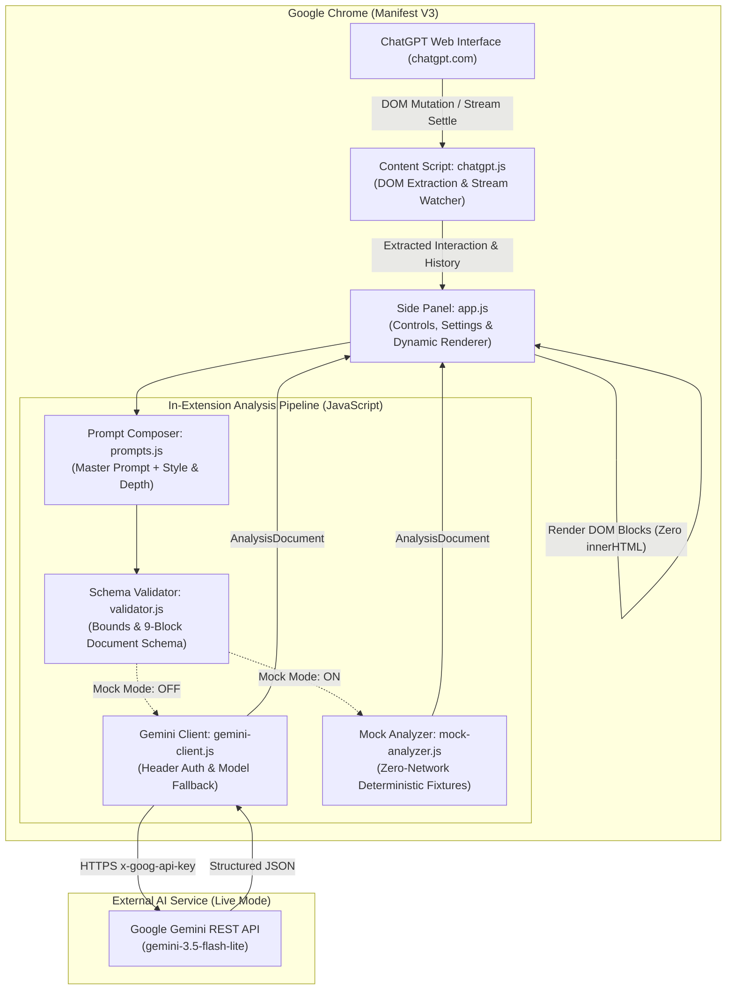

# Why Did AI Do That? (WDAIDT)

> **Ever wonder why ChatGPT answered your prompt the way it did?**  
> WDAIDT is a browser extension that lives in your Chrome side panel, providing real-time, evidence-based diagnostic explanations and ready-to-use follow-up prompts for your ChatGPT conversations.

[Repository](https://github.com/castlekrishna/WDAIDT) · [Submission Audit](docs/SUBMISSION_READINESS.md) · [Changelog](docs/CHANGELOG.md) · [Release Notes (V2.0.0)](docs/V2.0.0.md) · [Release Notes (V1.0.0)](docs/V1.0.0.md)

---

## About the Project

When working with ChatGPT, developers, researchers, and creators frequently encounter responses that take unexpected architectural paths, omit critical constraints, make unstated assumptions, or misunderstand the broader goal. Until now, figuring out *why* meant guessing, re-reading massive blocks of text, or entering tedious back-and-forth prompt debates.

**Why Did AI Do That? (WDAIDT)** gives you instant diagnostic X-ray vision directly in your browser sidebar. It captures completed ChatGPT exchanges, evaluates what visible evidence and constraints shaped the AI's reply, and presents clean, structured explanations accompanied by concrete, copyable next prompts.

### Epistemic Boundary

WDAIDT offers interpretations grounded strictly in visible conversation evidence. It evaluates what instructions were present, what trade-offs were skipped, and how phrasing shaped the outcome.

> [!NOTE]
> WDAIDT does not access hidden model weights, private internal activations, or private chains of thought. Explanations use hedged, epistemically honest phrasing (*"The response appears to...", "Seems to prioritize..."*) rather than asserting unobservable facts about the model's internal calculations.

---

## What the Project Does (What You Can Do With It)

WDAIDT transforms ChatGPT into a transparent, debuggable AI workspace:

- **Instant One-Click Diagnosis ("Why?")**: Click the **Why?** button at any point in your chat to instantly analyze the latest exchange. See what constraints were honored, what trade-offs were omitted, and what assumptions were made.
- **Auto-Pilot Analysis**: Toggle the **Auto** switch to `ON`, and WDAIDT automatically diagnoses new replies the moment ChatGPT finishes generating text.
- **Actionable Follow-Up Prompts**: Stop wondering what to ask next. WDAIDT suggests ready-to-use next prompts (`next_prompt`) with a dedicated **1-click copy** button so you can steer the AI immediately.
- **Multi-Turn Context Reasoning**: WDAIDT remembers earlier conversation turns (up to 10 previous exchanges) to detect when ChatGPT forgot a constraint you set 4 messages ago or contradicted an earlier clarification.
- **9 Rich Document Content Blocks**: Explanations are rendered as dynamic, editor-like documents supporting headings, explanatory paragraphs, lists, copyable code snippets, blockquotes, tables, semantic callout alerts (`warning`, `info`, `tip`, `note`, `caution`), section dividers, and suggested prompts.
- **One-Click Markdown Export**: Click **Copy** in the side panel header to export the entire diagnostic report as formatted Markdown for your notes, documentation, or team chat.
- **Zero-Setup Mock Mode & Live Gemini**: Test the extension immediately with zero API keys using built-in hermetic Mock Mode, or connect your Google Gemini API key for live analysis.
- **Smart Error Recovery**: If your local server disconnects, WDAIDT retains your captured interaction in memory. Once restarted, clicking **Retry** instantly re-analyzes without making you re-select tabs or re-scroll.

---

## Settings & Customization

Click the **Gear icon** in the side panel header to open the Settings drawer and customize how WDAIDT explains responses:

### 1. Explanation Depth
Choose how detailed the diagnostic report should be:
- **Brief** (Default): Concise, high-impact diagnosis and primary next action (1–2 blocks). Perfect for rapid, distraction-free workflow.
- **Balanced**: Standard diagnostic breakdown of omissions, trade-offs, and next steps (3–5 blocks).
- **Detailed**: Comprehensive breakdown covering nuances, edge cases, subtle assumptions, and verification prompts.

### 2. Response Style (Tone)
Tailor the voice of the generated explanation:
- **Friendly and conversational** (Default): Warm, encouraging, approachable, and clear while maintaining technical accuracy.
- **Lighthearted and witty**: Clever and engaging with subtle wit.
- **Casual and natural**: Relaxed, conversational phrasing.
- **Professional and direct**: Concise, objective, action-oriented.
- **Formal and precise**: Rigorous terminology and structured phrasing.
- **Academic and analytical**: Systematic scholarly breakdown.
- **Custom instructions**: Reveals a dedicated textarea allowing you to supply custom personality or domain guidance (up to 1,000 characters).

### 3. Context Window (Conversation Memory)
Configure how many previous conversation exchanges Gemini evaluates alongside the latest interaction:
- **5 previous exchanges** (Default)
- **0 previous exchanges** (Current turn only)
- **3 previous exchanges**
- **10 previous exchanges**

> [!IMPORTANT]
> The context window is a **maximum budget, not a minimum requirement**. If your conversation has fewer turns than the setting, WDAIDT analyzes the available turns without stalling or inventing fake turns.

All preferences persist automatically across browser sessions in `chrome.storage.local`.

---

## Quick Start & Installation

Get up and running in under **1 minute** — no Python, local server, or terminal required!

### 1. Download the Extension

#### Option A: Clone with Git (Recommended)
```bash
git clone https://github.com/castlekrishna/WDAIDT.git
cd WDAIDT
```

#### Option B: Download ZIP
Download and extract the repository ZIP: [Download WDAIDT ZIP](https://github.com/castlekrishna/WDAIDT/archive/refs/heads/main.zip).

---

### 2. Load the Extension in Google Chrome

1. Open Google Chrome and go to `chrome://extensions`.
2. Turn ON **Developer mode** (toggle in the upper-right corner).
3. Click **Load unpacked** (button in the upper-left corner).
4. Select the `extension/` directory inside your cloned or extracted repository.
5. That's it! **Why Did AI Do That?** is now installed (version 2.0.0).

---

### 3. Open ChatGPT and Run Your First Analysis

1. Visit [https://chatgpt.com](https://chatgpt.com) (or `https://chat.openai.com`).
2. Click the puzzle-piece icon in your Chrome toolbar and **pin** the WDAIDT extension icon.
3. Click the WDAIDT icon to open the **Side Panel**.
4. **Choose your evaluation mode**:
   - **Offline Mock Mode (Zero Setup)**: Toggle Mock Mode ON in Settings (gear icon) to test explanations immediately without an API key or internet access.
   - **Live Google Gemini Mode**: Click the gear icon in the top right, enter your Gemini API key from [Google AI Studio](https://aistudio.google.com/), and close settings. The status indicator will switch to `Gemini: Ready`.
5. Chat with ChatGPT as normal (e.g. ask: *"Write a quicksort in C"*).
6. Click **Why?** to see an instant diagnostic breakdown and a suggested follow-up prompt!

> [!NOTE]
> **Archived V1 Python Backend**: The original Python/FastAPI local server remains preserved in the `backend/` directory for historical reference and parity testing, but is **no longer required** for normal extension use in V2.0.0. To run the legacy V1 backend, see [V1.0.0 Release Notes](docs/V1.0.0.md).

---

## How It Works (Under the Hood)

WDAIDT coordinates capture, context budgeting, prompt composition, and dynamic rendering across its extension and backend components:



### Data Flow

1. **DOM Capture**: When triggered manually (**Why?**) or automatically (**Auto**), the content script extracts the latest completed user prompt and assistant response from the active ChatGPT conversation DOM.
2. **Context Budgeting**: If configured (3, 5, or 10 previous exchanges), preceding turns are extracted in chronological order. Context size budgets (30,000 characters client-side, 40,000 characters acceptance) are enforced by shedding older complete exchanges first.
3. **In-Browser Pipeline**: The side panel passes conversation text to `prompts.js`, packaging the exchange inside passive XML delimiters (`<CURRENT_INTERACTION>` and `<CONVERSATION_HISTORY>`) and composing the master system prompt with user-selected style and depth guidance.
4. **Diagnostic Generation**:
   - In **Live Mode**, `gemini-client.js` sends an authenticated HTTPS request directly to the Google Gemini API (`gemini-3.5-flash-lite`, with automatic fallback to `gemini-flash-latest` and `gemini-3.8-flash`).
   - In **Mock Mode**, `mock-analyzer.js` generates realistic diagnostic findings instantly and deterministically with zero network calls and no API key required.
5. **Schema Validation & Safe Rendering**: Output is verified against the 9-block `AnalysisDocument` specification in `validator.js`. The side panel renders the document safely using native DOM elements (`textContent`), avoiding any `innerHTML` injection.

---

## Technology Stack

### Chrome Extension (V2.0.0 Standalone Runtime)
- **Platform**: Chrome Manifest V3
- **APIs**: Chrome Side Panel API (`chrome.sidePanel`), Chrome Storage API (`chrome.storage.local`), Chrome Scripting & Tabs
- **Frontend & Pipeline**: Vanilla JavaScript (ES2022), semantic HTML5, modern CSS3 custom properties
- **Direct AI Integration**: Google Generative Language REST API (`gemini-3.5-flash-lite`) via HTTPS header authentication
- **Offline Mock Engine**: In-memory deterministic mock analyzer generating valid 9-block documents
- **Security**: Pure DOM element construction (`textContent`), zero `innerHTML` usage, Content Security Policy compliant
- **Testing**: Node.js built-in test runner (`node:test`, `node:assert`) — 162 passing automated tests

---

## Architecture and Repository Structure

```text
WDAIDT/
├── .gitignore                      # Git exclusion rules (secrets, node_modules, caches)
├── LICENSE                         # Open-source MIT license
├── README.md                       # Permanent project documentation & overview
├── devpost/                        # Devpost Learn AI Basics workspace artifacts
│   ├── app-map.html                # Standalone visual architecture map & code tour
│   ├── checklist.md                # 12-slice milestone verification checklist
│   ├── prd.md                      # Product requirements artifact
│   ├── scope.md                    # Project scope artifact
│   ├── skillpack-usage.md          # Skill Pack alignment & recommendations report
│   └── spec.md                     # Technical specification artifact
├── docs/
│   ├── CHANGELOG.md                # Centralized historical changelog (V0.1–V2.0.0)
│   ├── SUBMISSION_READINESS.md     # Hackathon audit & compliance matrix
│   ├── V0.1.md - V0.9.3.md         # Historical milestone technical notes
│   ├── V1.0.0.md                   # V1.0.0 stable release technical notes
│   ├── V2.0.0-MIGRATION-PLAN.md    # V2.0.0 architecture & migration blueprint
│   └── V2.0.0.md                   # V2.0.0 standalone release technical notes
├── extension/
│   ├── manifest.json               # Manifest V3 configuration (v2.0.0)
│   ├── assets/                     # Extension icons (16px, 48px, 128px)
│   └── src/
│       ├── background/
│       │   └── service-worker.js   # Extension lifecycle & side panel opening
│       ├── content/
│       │   └── chatgpt.js          # DOM extraction engine & stream mutation watcher
│       ├── shared/
│       │   ├── config.js           # Central configuration, limits, model fallbacks
│       │   ├── messages.js         # Runtime message contracts & request_id guards
│       │   ├── prompts.js          # Master system prompt & runtime prompt composer
│       │   ├── validator.js        # Request validation & 9-block document schema
│       │   ├── mock-analyzer.js    # Zero-network deterministic mock analysis engine
│       │   └── gemini-client.js    # Direct Gemini REST client with model fallback
│       └── sidepanel/
│           ├── app.js              # Controller, settings UI, dynamic document renderers
│           ├── index.html          # Side panel markup & settings drawer
│           └── styles.css          # Obsidian pitch-black theme styling
└── tests/
    └── extension/                  # Node.js automated test suites (162 tests)
        ├── auto.test.js            # Auto Analyze debounce & watcher tests
        ├── capture.test.js         # DOM extraction & shadow-root tests
        ├── capture_audit.test.js   # Layout bounds & full-text preservation tests
        ├── context.test.js         # Multi-context window & budgeting tests
        ├── day1.smoke.test.js      # Manifest & baseline contract tests
        ├── gemini_client.test.js   # Gemini REST client, auth, model fallback tests
        ├── integration.test.js     # Communication & retry recovery tests
        ├── integration_v2.test.js  # V2 standalone pipeline & settings integration tests
        ├── mock_analyzer.test.js   # Offline mock engine tests
        ├── pipeline.test.js        # Extraction-to-request pipeline tests
        ├── prompts.test.js         # Master prompt & style/depth composition tests
        ├── renderer.test.js        # Dynamic document block rendering tests
        ├── settings.test.js        # Settings UI, config, storage tests
        └── validator.test.js       # Request & 9-block document validation tests
```

---

## Testing

WDAIDT maintains a comprehensive 162-test automated regression baseline using the built-in Node.js test runner:

```bash
node --test tests/extension/*.test.js
```

### Coverage Areas
- **DOM Extraction**: Multi-strategy fallback hierarchy, Shadow DOM traversal, SPA client-side navigation.
- **Stream Monitoring**: MutationObserver debounce watcher, settled turn detection, streaming suppression.
- **Prompt Composition & Epistemic Boundaries**: Style guidance, depth presets, passive XML interaction isolation.
- **Document & Schema Validation**: Bounds checking, 9-block discriminated union parsing, code fence stripping.
- **Gemini REST Client**: HTTPS header authentication, candidate model fallback (404/503), error sanitization.
- **Offline Mock Engine**: Zero-network deterministic mock generation matching all document types.
- **Settings & UI State**: Accordion drawers, status indicator synchronization, `chrome.storage.local` persistence.

- **Observed Verification Result**: **162 passed**, 0 failed, 0 skipped (~1.3 seconds runtime).

---

## Privacy and Security

- **Ephemeral In-Memory Processing**: Conversation text is processed exclusively in memory to construct analysis prompts. Data is **never stored** in external databases, vector indexes, or server disks.
- **Secure Local Storage**: API keys and preferences are stored strictly on the user's device in Chrome's sandboxed `chrome.storage.local`.
- **Credential Protection**: When calling the Gemini API, the key is transmitted via the secure `x-goog-api-key` HTTPS header. It is never included in URLs, query strings, or error messages.
- **Zero Tracking & Telemetry**: WDAIDT contains zero analytics, tracking beacons, or third-party advertising scripts.
- **Passive Data Demarcation**: Untrusted user dialogue is isolated inside `<CURRENT_INTERACTION>` and `<CONVERSATION_HISTORY>` XML delimiters within the analysis prompt, preventing user-submitted conversation text from overriding system instructions.
- **Safe DOM Rendering**: All diagnostic blocks are constructed using safe DOM element properties (`textContent`), with zero `innerHTML` injection.

---

## Limitations

- **ChatGPT Interface Changes**: WDAIDT extracts conversation elements using a multi-strategy selector hierarchy. If OpenAI significantly restructures its DOM markup or class attributes, an updated content script release may be required.
- **AI Quota & Network**: When live analysis is enabled, an active internet connection and valid Gemini API credentials with sufficient quota are required. Evaluators without API keys can use hermetic Mock Mode.
- **Supported Platforms**: WDAIDT is currently built and verified specifically for ChatGPT (`chatgpt.com` and `chat.openai.com`).

## Contributors

WDAIDT was created and developed by:

| Contributor | GitHub Profile | Primary Contributions |
|---|---|---|
| **Krishna Kumar** | [@castlekrishna](https://github.com/castlekrishna) | FastAPI backend implementation, Pydantic schemas, Gemini API integration, prompt design & composition, mock analysis engine, backend unit tests & quality evaluations. |
| **Lidiya** | [@alwaysalearner1234](https://github.com/alwaysalearner1234) | Chrome Extension Manifest V3 architecture, ChatGPT multi-tier DOM capture engine, side panel interface, Obsidian theme styling, Auto Analyze watcher, extension unit & integration tests. |

*Architecture design, integration testing, documentation, and evaluation walkthroughs were conducted collaboratively.*

---

## Roadmap

Future capabilities planned for subsequent releases:
- **Additional AI Platforms**: Expanding DOM extraction support to Claude and Google Gemini web interfaces.
- **Custom Block Renderers**: Support for inline interactive flowcharts and collapsible diff views.
- **Diagnostic History Export**: Optional local export of diagnostic documents to JSON or Obsidian vault formats.

---

## License and Acknowledgments

### License
Distributed under the [MIT License](LICENSE). Copyright (c) 2026 Krishna Kumar, Lidiya.

### Acknowledgments
- Built with [Google Gemini](https://ai.google.dev/) and the Google GenAI SDK.
- Powered by [FastAPI](https://fastapi.tiangolo.com/) and [Pydantic](https://docs.pydantic.dev/).
- Designed for [Google Chrome Extensions](https://developer.chrome.com/docs/extensions/).

---

## Documentation

- [V2.0.0 Technical Notes](docs/V2.0.0.md): Standalone Manifest V3 Chrome extension, direct Gemini REST integration, and zero-network Mock Mode.
- [V2.0.0 Migration Plan](docs/V2.0.0-MIGRATION-PLAN.md): Architectural roadmap and technical specifications for the V2 pure-JavaScript migration.
- [Submission Audit & Readiness Report](docs/SUBMISSION_READINESS.md): Hackathon compliance matrix, official rule verification, and release evaluation.
- [Changelog (V0.1 – V2.0.0)](docs/CHANGELOG.md): Complete release history from the initial foundation through stable release.
- [V1.0.0 Technical Notes](docs/V1.0.0.md): Final stabilization, verification, and release notes.
- [V0.9.3 Technical Notes](docs/V0.9.3.md): Final Skill Pack alignment audit, takeaway architecture map, and compliance verification.
- [V0.9.2 Technical Notes](docs/V0.9.2.md): Submission readiness, hackathon compliance audit, and planning artifact synchronization.
- [V0.9 Technical Notes](docs/V0.9.md): Release readiness, usability audit, and verification report.
- [V0.8 Technical Notes](docs/V0.8.md): Stabilization, integration hardening, and reliability audit.
- [V0.7 Technical Notes](docs/V0.7.md): Multi-context analysis architecture and size budgeting.
- [V0.6 Technical Notes](docs/V0.6.md): Dynamic document schema and quality overhaul.
- [Historical Version Notes](docs/): Technical records for [V0.5](docs/V0.5.md), [V0.4](docs/V0.4.md), [V0.3](docs/V0.3.md), [V0.2](docs/V0.2.md), and [V0.1](docs/V0.1.md).
- **Skill Pack & Planning Artifacts**: [Skill Pack Usage Report](devpost/skillpack-usage.md) · [Visual Architecture Map](devpost/app-map.html) · [Scope](devpost/scope.md) · [PRD](devpost/prd.md) · [Spec](devpost/spec.md) · [Milestone Checklist](devpost/checklist.md)
