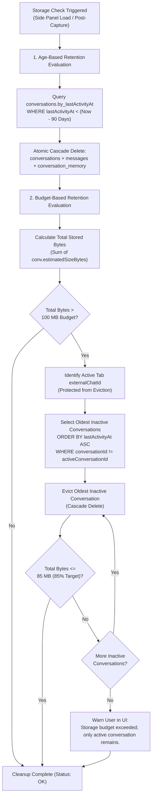
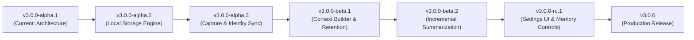

# WDAIDT v3.0.0-alpha.1 Architecture: Local Conversation Memory & Historical Context

**Milestone:** `v3.0.0-alpha.1`  
**Target Development Branch:** `feature/v3-conversation-memory`  
**Base Release:** `v2.1.0` (commit `cde84c7`)  
**Status:** Architecture Specification & Foundation (No runtime feature implementation)  
**Date:** October 26, 2026  

---

## 1. Executive Summary & Scope Boundary

WDAIDT V2.1.0 operates as a self-contained Chrome Manifest V3 browser extension providing real-time, evidence-based diagnostic explanations and follow-up prompts for ChatGPT responses. Analysis currently operates on an ephemeral interaction basis: when the user triggers analysis manually (**Why?**) or automatically (**Auto**), the content script extracts the latest exchange plus up to 10 preceding exchanges visible in the active ChatGPT DOM, passing them to Google's Gemini API (`gemini-3.5-flash-lite` with candidate fallbacks) or an offline deterministic Mock Analyzer.

**V3.0.0 Objective:** Introduce a privacy-preserving, production-grade **Local Conversation Memory System** powered by native browser IndexedDB. This system will persist conversation history locally, maintain compact incremental summaries, and supply rich historical context to the diagnostic analyzer even when ChatGPT virtualizes or unmounts older DOM turns.

### Scope Restrictions for `v3.0.0-alpha.1`:
- **Architecture-First:** Define the architectural blueprint, storage schemas, identity reconciliation strategies, retention algorithms, context retrieval interfaces, and testing contracts.
- **Zero Runtime Behavior Alteration:** Do not implement IndexedDB runtime logic, modify existing content script extraction, change the Gemini analysis prompt or model configurations, or alter sidepanel runtime behavior in this stage.
- **Zero UI Redesign:** Do not redesign settings or add premature UI widgets in this stage.
- **No External Cloud / Backend:** Maintain 100% backend independence; all storage remains strictly on the user's local device in IndexedDB.
- **Version Integrity:** Keep manifest and runtime versions at `2.1.0`. Do not publish a release or create a version tag.

---

## 2. Current Architecture & Data-Flow Assessment

### 2.1 Component Breakdown

```
[ ChatGPT Tab (chatgpt.com / chat.openai.com) ]
  │
  ├─ DOM MutationObserver (Auto-Analyze watcher, 2000ms debounce)
  └─ Content Script: src/content/chatgpt.js
       │  - 6-tier fallback extraction:
       │      1. role-attributes ([data-message-author-role])
       │      2. message-id ([data-message-id])
       │      3. conversation-turns ([data-testid*="conversation-turn"])
       │      4. articles (main article, article)
       │      5. modern-turns (.markdown, .prose, .whitespace-pre-wrap)
       │      6. content-blocks (structural text blocks inside main)
       │  - Shadow DOM piercing traversal
       │  - Multi-turn exchange pairing (pairExchanges)
       │
       │ (Chrome Runtime Messaging: WDAIDT_GET_LATEST / WDAIDT_AUTO_ANALYZE_TRIGGER)
       ▼
[ Extension Side Panel: src/sidepanel/ ]
  ├─ Controller: app.js
  │    - Request orchestration & stale result guard (wdaidtIsStaleResult)
  │    - In-memory ephemeral interaction cache (lastCapture for Retry)
  │    - Safe DOM rendering (renderBlock, native textContent, zero innerHTML)
  │    - Context budgeting (filterContextExchanges: 0, 3, 5, 10 turns; max 30k chars)
  │    - Settings state & persistence (chrome.storage.local)
  │
  ├─ Shared Modules: src/shared/
  │    ├─ config.js: Endpoints, storage keys, limits (8k prompt, 20k response, 30k context)
  │    ├─ messages.js: Contract definitions (WDAIDT_MESSAGES)
  │    ├─ prompts.js: Master system prompt & passive XML packing (<CURRENT_INTERACTION>, <CONVERSATION_HISTORY>)
  │    ├─ validator.js: Request normalization & 9-block AnalysisDocument schema validation
  │    ├─ mock-analyzer.js: Hermetic offline analysis engine
  │    └─ gemini-client.js: Direct REST client (x-goog-api-key header auth, candidate fallback)
  │
  └─ Background Service Worker: src/background/service-worker.js
       - Side panel action click routing & initial default setting bootstrap
```

### 2.2 Trace of Existing Runtime Flows

1. **Manual Analysis ("Why?"):**
   - User clicks `whyBtn` in `app.js`.
   - `captureLatest()` queries the active tab and sends `WDAIDT_GET_LATEST` to `chatgpt.js`.
   - `chatgpt.js` runs `getLatestInteraction()`, scanning DOM nodes in `chatScope()` across the 6 extraction strategies.
   - `pairExchanges()` isolates the latest user message and the trailing assistant reply, bundling all preceding completed exchanges into `res.history`.
   - `app.js` receives payload, applies character trimming (`trimForBackend`: 8k prompt, 20k response), filters history via `filterContextExchanges` according to `settingsState.contextWindow` (default 5 turns, max 30,000 characters), and caches the exchange in memory as `lastCapture`.
   - `analyzeCapture()` dispatches payload to `postAnalyze()`. In Mock Mode, `mock-analyzer.js` produces deterministic blocks; in Live Mode, `gemini-client.js` executes an HTTPS POST to Google's Generative Language API.
   - Response passes through `cleanJsonText()`, `validateAnalysisDocument()`, and is rendered via safe DOM manipulation (`renderBlock()`).

2. **Auto-Analyze Workflow:**
   - User enables the `autoToggle` switch, persisting `wdaidt_auto_analyze: true` to `chrome.storage.local`.
   - `chatgpt.js` receives `WDAIDT_AUTO_ANALYZE_ON`, arms a `MutationObserver` on `document.documentElement` / `document.body`.
   - When ChatGPT streams a reply, continuous DOM mutations reset `autoSchedule()`.
   - Once mutations settle for `AUTO_DEBOUNCE_MS` (2,000 ms), `autoCheck()` captures the latest exchange.
   - If the exchange is complete (`paired: true`) and its fingerprint hash differs from `lastNotifiedHash`, it fires `WDAIDT_AUTO_ANALYZE_TRIGGER` to `chrome.runtime.sendMessage()`.
   - `app.js` debounces runtime messages by 500 ms and executes `runAuto()`.

3. **Retry Workflow:**
   - If an analysis request fails due to transient network interruption, API rate limiting, or invalid configuration, `showError()` reveals the `retryBtn`.
   - `lastCapture` remains cached in memory in `app.js`. Clicking **Retry** invokes `runRetry()`, immediately re-submitting `lastCapture` and its normalized context without refocusing the tab or re-reading the DOM.

### 2.3 Current Limitations & Memory Deficiencies

1. **Ephemeral Interaction Cache:** `lastCapture` and `history` exist strictly in volatile window memory. Closing the side panel, reloading the page, or switching browser tabs discards captured exchanges.
2. **DOM Virtualization Blind Spot:** Modern Single-Page Applications (SPAs) like ChatGPT aggressively virtualize long threads, unmounting earlier DOM turns to conserve memory. Once unmounted from the DOM, earlier exchanges cannot be captured by `pairExchanges()`.
3. **Mid-Thread Evaluation Gaps:** When a user opens WDAIDT midway through a long thread (e.g. at turn 15), WDAIDT only sees the turns currently rendered in the DOM, with zero access to earlier constraints, previous diagnostic insights, or original setup requirements.
4. **Lack of Cumulative Memory:** The current context window (`filterContextExchanges`) simply passes raw prior exchanges verbatim up to 30,000 characters. As conversations grow, older exchanges are dropped completely, with no synthesis, key constraint tracking, or cumulative understanding.

---

## 3. Proposed IndexedDB Architecture

To overcome ephemeral limits without compromising privacy or introducing external servers, WDAIDT v3 will introduce a dedicated local database using native browser IndexedDB.

### 3.1 Database Identity & Versioning
- **Database Name:** `wdaidt_local_db`
- **Initial Version:** `1`
- **Execution Context:** The sidepanel and background contexts share origin access (`chrome-extension://<EXTENSION_ID>`). All write transactions will be managed by a centralized, robust storage module (`src/shared/db.js`).

### 3.2 Object Store Specifications

#### 1. `conversations` Store
Stores conversation session metadata, tracking status, and summary progress.

- **Primary Key:** `conversationId` (string, UUIDv4 for local identity, or provisional ID `prov_<timestamp>_<random>`)
- **Fields:**
  - `conversationId` (string, PK): Stable internal identifier.
  - `platform` (string): Always `'chatgpt'` for Manifest V3 scope.
  - `externalChatId` (string | null): The ChatGPT conversation UUID extracted from URL (`/c/:id`) or DOM. `null` for new chats before the first response.
  - `title` (string | null): Conversation title (captured from DOM navigation header/sidebar or derived from prompt 1).
  - `createdAt` (number): Unix epoch millisecond timestamp of conversation discovery.
  - `lastActivityAt` (number): Unix epoch millisecond timestamp of the latest captured exchange or analysis.
  - `completenessStatus` (string): Enum `['complete', 'partial', 'provisional']`.
  - `lastCapturedMessageId` (string | null): Foreign key to the latest captured message in `messages`.
  - `messageCount` (number): Total messages stored under this conversation.
  - `estimatedSizeBytes` (number): Running byte tally of conversation records, messages, and summary.
  - `summaryVersion` (number): Schema version of the attached summary (`0` if unsummarized).
  - `summaryUpdatedAt` (number | null): Timestamp of last summary update.
- **Indexes:**
  - `by_externalChatId`: Key path `['platform', 'externalChatId']`, `unique: false`. Allows fast lookup when URL transitions to a permanent chat ID.
  - `by_lastActivityAt`: Key path `'lastActivityAt'`, `unique: false`. Used for LRU retention and cleanup ordering.
  - `by_completenessStatus`: Key path `'completenessStatus'`, `unique: false`. Facilitates recovery audits.

#### 2. `messages` Store
Stores the immutable, full-fidelity record of each captured user prompt and assistant response. Captured messages remain the single source of truth.

- **Primary Key:** `messageId` (string, UUIDv4 or `cId:seq:role`)
- **Fields:**
  - `messageId` (string, PK): Stable internal message identifier.
  - `conversationId` (string, FK): Reference to parent `conversations.conversationId`.
  - `role` (string): `'user'` | `'assistant'`.
  - `content` (string): Complete captured text, preserving formatting, whitespace, code blocks, and markdown.
  - `sourceMessageId` (string | null): ChatGPT DOM `data-message-id` attribute when available.
  - `turnSequence` (number): Strict 0-indexed monotonic integer representing chronological position in the thread.
  - `sourceTimestamp` (number | null): Creation timestamp if exposed by DOM attributes; `null` if unavailable.
  - `capturedAt` (number): Local timestamp when WDAIDT captured the message.
  - `edited` (boolean): `true` if content was modified or regenerated.
  - `contentVersion` (number): Integer starting at `1`, incremented on response regeneration or prompt edit.
  - `contentHash` (string): 64-character SHA-256 or 32-bit fast murmur/fnv hash of normalized content for rapid deduplication.
  - `estimatedSizeBytes` (number): Estimated byte footprint (`content.length * 2` + metadata).
  - `captureStatus` (string): Enum `['complete', 'streaming', 'partial']`.
- **Indexes:**
  - `by_conversationId`: Key path `'conversationId'`, `unique: false`. Fetch all messages in a conversation.
  - `by_conv_sequence`: Key path `['conversationId', 'turnSequence']`, `unique: true`. Guarantees turn order and prevents duplicate sequence assignment.
  - `by_conv_sourceId`: Key path `['conversationId', 'sourceMessageId']`, `unique: false`. Facilitates DOM ID reconciliation.
  - `by_capturedAt`: Key path `'capturedAt'`, `unique: false`. Supports global age-based retention queries.
  - `by_conv_capturedAt`: Key path `['conversationId', 'capturedAt']`, `unique: false`. Supports scoped range queries.

#### 3. `conversation_memory` Store
Stores compact, incremental conversational summaries and extracted constraints. Summaries are strictly derived artifacts and never replace original messages.

- **Primary Key:** `conversationId` (string, PK, 1:1 relationship with `conversations`)
- **Fields:**
  - `conversationId` (string, PK): Reference to parent conversation.
  - `summaryVersion` (number): Schema version of the summary structure (e.g., `1`).
  - `updatedAt` (number): Timestamp of latest summary generation.
  - `coveredRange` (object): Message span covered by summary: `{ fromSequence: number, toSequence: number, fromCapturedAt: number, toCapturedAt: number }`.
  - `sourceMessageCount` (number): Count of historical messages synthesized into this summary.
  - `compactSummary` (string): Structured, concise narrative (approx. 500–1,500 characters) detailing objectives, established solutions, and topic evolution.
  - `activeTopics` (string[]): Array of short topic tags (e.g. `["quicksort", "memory safety", "C99"]`).
  - `constraints` (string[]): Explicit user constraints extracted from history (e.g. `["no third-party libraries", "target POSIX compliant"]`).
  - `status` (string): Enum `['ready', 'generating', 'stale', 'failed']`.
  - `retryCount` (number): Sequential retry attempts for summary generation.
  - `lastError` (string | null): Error message if summary generation failed.
  - `estimatedSizeBytes` (number): Memory footprint of summary record.
- **Indexes:**
  - `by_updatedAt`: Key path `'updatedAt'`, `unique: false`.
  - `by_status`: Key path `'status'`, `unique: false`.

### 3.3 Transaction Boundaries & Concurrency Guarantees
- **Atomic Interaction Capture:** When storing a captured interaction (user prompt + assistant response), a single `readwrite` transaction spans `['conversations', 'messages']`. If any write fails (e.g. sequence conflict), the transaction aborts cleanly, preventing orphaned messages or desynchronized conversation metadata.
- **Isolated Summary Transactions:** Summary updates operate in a separate `readwrite` transaction spanning `['conversations', 'conversation_memory']`. Summary generation runs asynchronously in the background and never locks the `messages` store or blocks active diagnostic analysis.
- **Source of Truth Invariant:** Original message text in `messages` is immutable. If a summary update fails or produces unexpected formatting, original message history remains completely intact.

---

## 4. Message Identity & Capture Recovery Strategy

ChatGPT DOM structures evolve frequently, and message identity cannot rely on a single attribute or naive string matching.

### 4.1 URL Dynamics & Provisional Conversation Reconciliation

```
[ New Chat Initial State: URL = "https://chatgpt.com/" ]
  │
  ├─ User enters prompt -> Assistant streams reply.
  ├─ WDAIDT captures interaction:
  │    - No permanent chat UUID in URL.
  │    - Generate provisional conversationId: "prov_1729960000000_x8f9"
  │    - externalChatId: null
  │    - completenessStatus: 'provisional'
  │    - Messages stored under "prov_1729960000000_x8f9"
  │
[ ChatGPT Navigation State: URL updates via pushState to "/c/671d..." ]
  │
  ├─ Content script or Side Panel detects URL transition.
  ├─ Reconciliation Algorithm:
  │    1. Extract new externalChatId ("671d...").
  │    2. Query conversations.by_externalChatId for "671d...".
  │    3. If existing conversation found:
  │         - Merge provisional messages into existing conversation.
  │         - Re-index turnSequence starting after existing max sequence.
  │         - Delete provisional conversation record.
  │    4. If not found:
  │         - Promote provisional record: set externalChatId = "671d...".
  │         - Update completenessStatus = 'complete'.
```

### 4.2 Multi-Tier Message Identity Matrix

| Scenario | Primary Identifier | Verification & Fallback | Handling Strategy |
| :--- | :--- | :--- | :--- |
| **DOM exposes `data-message-id`** | `sourceMessageId` (DOM UUID) | Verify parent conversation and role. | Direct upsert. If `contentHash` matches, ignore duplicate observation. |
| **DOM lacks `data-message-id` (Strategy 3–6)** | Synthetic Turn Hash: `SHA256(convId + turnIndex + role + prefix60)` | Relative DOM ordering in `chatScope()` combined with role. | Assign monotonic `turnSequence`. Check existing sequence slot before write. |
| **Identical Text in Separate Messages** | Unique `turnSequence` + distinct `capturedAt` | Never deduplicate purely by content hash. Position in thread distinguishes separate identical messages (e.g. repeated "yes" prompts). | Distinct message records created with sequential `turnSequence`. |
| **Edited User Prompt** | `sourceMessageId` or matching `turnSequence` | Content hash differs from existing turn record. | Increment `contentVersion`, set `edited: true`, archive prior version in audit metadata. |
| **Regenerated Assistant Response** | Matching `turnSequence` for role `'assistant'` | In `chatgpt.js`, `pairExchanges()` always selects the last assistant node after the prompt (`turnAssts[turnAssts.length - 1]`). | Update active assistant message record, increment `contentVersion`, mark summary as `stale`. |
| **Incomplete Streaming Response** | `captureStatus: 'streaming'` | Content script skips empty nodes during streaming. Auto-analyze enforces `AUTO_DEBOUNCE_MS = 2000ms`. | Only settled, complete exchanges (`paired: true`) trigger persistent summary updates. |
| **SPA Navigation Between Chats** | URL change detection (`location.href`) | Side panel tracks active tab URL on each capture. | Active conversation context switches immediately to the matching `externalChatId`. |
| **Mid-Thread Discovery (Partial Capture)** | Flagged as `completenessStatus: 'partial'` | WDAIDT records the first captured turn with sequence `0` (or DOM turn offset if visible) and notes partial history. | Does not fabricate missing past turns. Summary covers explicitly captured range. |

### 4.3 Service Worker & Browser Lifecycle Recovery
- In Chrome Manifest V3, background service workers terminate after ~30 seconds of inactivity.
- Native IndexedDB persists indefinitely within the extension origin, surviving service worker termination, browser restarts, and tab reloads.
- When the side panel opens or wakes, it inspects the active tab URL, queries IndexedDB for existing conversation records, and hydrates state in < 15 ms without touching the DOM or invoking network calls.

---

## 5. Storage Accounting, Retention, and Cleanup Algorithm

To prevent unbounded disk consumption while respecting Chrome extension storage dynamics, WDAIDT implements a dual-mode retention engine: **Age-Based Expiration** and **Budget-Based LRU Eviction**.

### 5.1 Storage Preferences & Default Constants
- `DEFAULT_STORAGE_BUDGET_BYTES`: `104,857,600` (100 MB target limit)
- `DEFAULT_RETENTION_DAYS`: `90` (90 days maximum inactivity age)
- `CLEANUP_HYSTERESIS_RATIO`: `0.85` (Evict down to 85% of budget [85 MB] to prevent thrashing)
- `SUMMARY_ENABLED`: `true`

> [!IMPORTANT]
> The 100 MB budget is a user-configurable extension management policy, not a physical hardware constraint or hard Chrome quota guarantee. Chrome allocates storage per origin based on total disk availability. Storage usage is tracked using calculated byte estimates (`estimatedSizeBytes`) supplemented by `navigator.storage.estimate()` where supported.

### 5.2 Storage Accounting Formula
For each stored record:
$$\text{estimatedSizeBytes} = (\text{string characters} \times 2) + \text{metadata overhead (approx. 128 bytes)}$$
Conversation total size is maintained incrementally:
$$\text{conv.estimatedSizeBytes} = \sum \text{msg.estimatedSizeBytes} + \text{memory.estimatedSizeBytes}$$

### 5.3 Retention & Cleanup Workflow



### 5.4 Edge Cases & Safety Guarantees
1. **Conversations with Mixed Age Messages:** Expiration is evaluated by `conversations.lastActivityAt`, not individual message age. If a conversation started 120 days ago was active yesterday, the entire conversation remains preserved intact. Messages are never partially sliced out from underneath a summary.
2. **Active Conversation Immunity:** The conversation currently active in the foreground ChatGPT tab is pinned and exempt from budget-based LRU eviction, preventing data loss while actively chatting.
3. **Exhaustion of Inactive Data:** If all inactive conversations have been evicted and the active conversation alone exceeds the budget, WDAIDT will NOT corrupt or delete active conversation turns. A non-intrusive warning badge (`"Storage budget exceeded (100 MB)"`) is surfaced in settings.
4. **Interrupted Cleanup Recovery:** If cleanup is interrupted by browser shutdown, IndexedDB transaction atomicity ensures no orphaned records remain. The cleanup cycle resumes idempotently on the next launch.
5. **Atomic Summary Erasure:** Deleting a conversation atomically erases its entry in `conversation_memory` within the same transaction, preventing stale summaries or leaked snippets from lingering in storage.

---

## 6. Historical Context Retrieval Strategy

The context retrieval engine bridges stored historical memory and the live diagnostic analyzer without overflowing LLM token windows or bogging down extension memory.

### 6.1 Composite Context Window Architecture

```
┌────────────────────────────────────────────────────────────────────────┐
│                        Gemini Analysis Request                         │
├────────────────────────────────────────────────────────────────────────┤
│ 1. Master System Prompt (prompts.js)                                  │
│    - Diagnostic principles, omission focus, anti-summarization rules    │
│    - User style & depth preferences                                    │
├────────────────────────────────────────────────────────────────────────┤
│ 2. Conversation Memory Summary (<CONVERSATION_MEMORY>)                  │
│    - Injected ONLY when historical turns precede the recent window     │
│    - Compact technical synthesis (approx. 500-1,500 characters)         │
│    - Explicit constraints & topics established in earlier exchanges    │
├────────────────────────────────────────────────────────────────────────┤
│ 3. Recent Conversation History (<CONVERSATION_HISTORY>)                │
│    - Last N complete exchanges (configured: 0, 3, 5, or 10 turns)      │
│    - Chronological raw dialogue format: [Exchange K] User / Assistant │
├────────────────────────────────────────────────────────────────────────┤
│ 4. Current Interaction (<CURRENT_INTERACTION>)                         │
│    - Target User Prompt (<USER_PROMPT>)                                │
│    - Target AI Response (<AI_RESPONSE>)                                │
└────────────────────────────────────────────────────────────────────────┘
```

### 6.2 Context Sizing & Character Budget Allocation
The existing V2 context budget allows up to 30,000 characters for context, with prompt maximum 8,000 chars and response maximum 20,000 chars (40,000 characters max acceptance in `validator.js`).

V3 enforces strict budget allocation:
- **Current Exchange:** Uncompromised priority (up to 8,000 chars prompt + 20,000 chars response).
- **Conversation Memory Summary:** Capped at `3,000` characters. Provides high-level grounding for earlier exchanges.
- **Recent Raw Exchanges:** Fills remaining context budget (up to `27,000` characters) selecting the most recent turns in reverse chronological order, dropping older complete exchanges if budget is exceeded.

### 6.3 Database Query Efficiency (RAM Protection)
- Retrieval does **not** load the entire conversation history into RAM.
- Query uses `IDBKeyRange.bound([convId, minSeq], [convId, maxSeq])` to fetch only the needed recent exchanges.
- The summary record is fetched by direct primary key lookup (`conversations.conversationId`), requiring $O(1)$ memory.

### 6.4 Preservation of Analysis Contract
- The backend/Gemini request contract remains `postAnalyze(prompt, response, requestId, context)`.
- When conversation memory is present, `context` items retain their standard schema (`{ prompt, response }`), and `prompts.buildAnalysisUserPrompt` safely incorporates the `<CONVERSATION_MEMORY>` block before `<CONVERSATION_HISTORY>`.
- **Epistemic Modesty Rule:** WDAIDT must make clear that conversation memory is an analytical aid for WDAIDT. It does **not** imply that ChatGPT's internal transformer context has been modified.

---

## 7. Gemini Summary Updates: Lifecycle & Failure Handling

Compact summaries allow WDAIDT to remember decisions across long sessions without exceeding context size limits.

### 7.1 Incremental Summary State Machine

```
              ┌────────────────────────┐
              │ Turn Captured & Settled│
              └───────────┬────────────┘
                          │ Unsummarized turns >= BATCH_THRESHOLD (e.g. 3)
                          ▼
              ┌────────────────────────┐
              │ Status: 'generating'   │◄───────────────┐
              └───────────┬────────────┘                │
                          │                             │ Retry
         ┌────────────────┴────────────────┐            │ (Exponential backoff)
         ▼                                 ▼            │
┌──────────────────┐             ┌──────────────────┐   │
│ Gemini REST Call │             │ Mock Mode Call   │   │
│ (Compact Schema) │             │ (Local Determin.)│   │
└────────┬─────────┘             └────────┬─────────┘   │
         │                                │             │
         ├────────────────┬───────────────┤             │
         │ Success        │ Error/Timeout │             │
         ▼                ▼               │             │
┌──────────────────┐    ┌─────────────────┴─┐           │
│ Validate Schema  │    │ Status: 'failed'  │───────────┘
└────────┬─────────┘    │ Log error; retain │
         │              │ prior summary.    │
         ▼              └───────────────────┘
┌──────────────────┐
│ Overwrite Guard: │
│ Check stale gen  │
└────────┬─────────┘
         │ Sequence matches target
         ▼
┌──────────────────┐
│ Status: 'ready'  │
│ Persist to DB    │
└──────────────────┘
```

### 7.2 Summary Prompt Specification
Summarization runs against Google's Generative Language API using a compact, structured instruction prompt:
- **Role:** Interaction summarizer extracting technical objectives, key constraints established, decisions confirmed, and pending follow-ups.
- **Constraints:** Max 1,500 characters, no conversational fluff, no meta-commentary, output strictly valid JSON matching schema:
  ```json
  {
    "summary": "Concise chronological synthesis of technical progress and decisions...",
    "activeTopics": ["topic1", "topic2"],
    "constraints": ["constraint1", "constraint2"]
  }
  ```

### 7.3 Concurrency & Stale Result Protection
- When a summary task initiates, it records `targetTurnSequence = N` and a unique `generationId`.
- If new messages are captured while the summary is in flight, the summary is still valid up to sequence `N`.
- If a subsequent summary task finishes earlier (or an older task resolves late), WDAIDT checks `sourceMessageCount`. A response with a lower message count or older timestamp is discarded, preventing stale overwrites.

### 7.4 Hermetic Mock Mode Separation
- When `wdaidt_mock_mode: true` is enabled, summary generation bypasses `gemini-client.js` entirely.
- A dedicated deterministic mock summarizer (`generateMockSummary()`) synthesizes topic tags and constraint lists based on observable lexical tokens, requiring zero network calls and zero API keys.

---

## 8. Security and Privacy Requirements

### 8.1 Local-First Privacy Policy
- All raw dialogue turns, message timestamps, turn sequences, and compact summaries are stored exclusively on the user's local device in IndexedDB.
- No interaction history is ever synced to third-party cloud databases, telemetry services, or WDAIDT servers.

### 8.2 Transparent Transmission Disclosure
- User messages are transmitted externally **only** when an active analysis is performed, connecting directly from the extension to `https://generativelanguage.googleapis.com` via the user's own API key.
- The UI must clearly indicate that live analyses transmit selected conversation context to Google under the Google AI terms of service.

### 8.3 Zero-Credential Ingress Invariant
- Google Gemini API keys (`wdaidt_gemini_api_key`) are stored strictly in `chrome.storage.local`.
- API keys are **never** stored in IndexedDB tables, embedded in conversation records, included in prompt dumps, or output to console logs.

### 8.4 User Deletion & Erasure Rights
- **Single Conversation Erasure:** Users can delete an individual conversation, which cascades to delete all associated messages and summaries immediately.
- **Global Wipe ("Clear All Memory"):** A single action purges the entire IndexedDB database (`indexedDB.deleteDatabase('wdaidt_local_db')`), resetting storage to zero.
- **Standard Extension Lifecycle:** Removing the extension from Chrome automatically triggers browser profile deletion of all associated IndexedDB and `chrome.storage.local` data.

### 8.5 Epistemic & Cryptographic Honesty
- WDAIDT will **not** claim "end-to-end encryption" or "military-grade database encryption." Storage is protected by Chrome's process isolation and operating system file-system security for the user profile.

---

## 9. Comprehensive Testing Strategy

In accordance with WDAIDT's zero-regression mandate, all v3 memory capabilities will be verified using Node.js built-in test runner (`node:test`, `node:assert/strict`) matching the existing 166 passing tests.

### 9.1 Planned Test Suites & Coverage Targets

| Test Suite File | Responsibility & Scenario Coverage |
| :--- | :--- |
| `tests/extension/db_schema.test.js` | Database initialization, schema creation, store definitions, index verification, version upgrade handling. |
| `tests/extension/db_crud.test.js` | Atomic insertion of conversations and messages, sequential turn queries, key constraints, cascade deletion. |
| `tests/extension/message_identity.test.js` | Deduplication of repeated DOM observations, handling identical message text across separate turns, edited prompts, and regenerated responses. |
| `tests/extension/reconciliation.test.js` | Provisional conversation creation on `/`, seamless merge when URL transitions to `/c/:id`, sequence gap prevention. |
| `tests/extension/retention_age.test.js` | Inactivity age calculation, expiration of 90+ day old conversations, preservation of active conversations with mixed-age turns. |
| `tests/extension/retention_budget.test.js` | Byte calculation verification, 100 MB budget LRU eviction, active tab conversation immunity, safe recovery on quota errors. |
| `tests/extension/context_retrieval.test.js` | Composite context assembly (Summary + History + Current), strict character limit enforcement (30k/40k bounds), zero RAM exhaustion. |
| `tests/extension/summary_lifecycle.test.js` | Summary state transitions (`generating` &rarr; `ready` / `failed`), stale result drop guards, failure recovery with original history preservation. |
| `tests/extension/mock_memory.test.js` | Hermetic offline mock summarization, deterministic output validation, zero network calls in Mock Mode. |
| `tests/extension/privacy_erasure.test.js` | Single conversation purge, total database wipe verification, confirmation of zero API key leaks in stored records. |
| `tests/extension/regression_v2.test.js` | Continuous validation that all existing 166 tests continue to pass without deviation. |

### 9.2 Acceptance Criteria for Milestone v3.0.0-alpha.1
- [x] Existing release `v2.1.0` (commit `cde84c7`) inspected and verified undamaged.
- [x] Branch `feature/v3-conversation-memory` cleanly branched from `main`.
- [x] All 166 existing automated tests executed and passing with 0 errors.
- [x] Architectural specification authored under `docs/V3.0.0-ALPHA.1-ARCHITECTURE.md`.
- [x] Zero runtime code or behavior modified in `extension/`.
- [x] Zero dependencies or cloud backends introduced.

---

## 10. Recommended Implementation Sequence for Future Milestones



1. **Milestone `v3.0.0-alpha.2`: Local Storage Engine**
   - Implement `extension/src/shared/db.js` providing native IndexedDB initialization, transactional CRUD wrappers, and error handling.
   - Author automated storage unit tests (`tests/extension/db_*.test.js`) verifying database creation and migrations in Node.js test environment using a clean in-memory/mock IDB implementation.

2. **Milestone `v3.0.0-alpha.3`: Capture & Identity Reconciliation**
   - Integrate `db.js` into side panel capture pipeline (`app.js`).
   - Implement provisional conversation tracking and URL-based reconciliation for ChatGPT SPA transitions.
   - Verify deduplication of streaming mutations and regenerated turns.

3. **Milestone `v3.0.0-beta.1`: Context Builder & Retention Engine**
   - Implement composite context retrieval combining stored history with active captures.
   - Implement age-based and budget-based LRU retention cleanup.
   - Verify context character budgeting under strict limits.

4. **Milestone `v3.0.0-beta.2`: Background Incremental Summarization**
   - Implement `summarizer.js` with structured Gemini summarization prompts and schema validation.
   - Implement offline mock summarizer for Mock Mode.
   - Verify concurrency guards and stale result prevention.

5. **Milestone `v3.0.0-rc.1`: Settings UI & Memory Controls**
   - Add conversation memory toggle, storage usage indicators, and "Clear Memory" controls to the settings panel.
   - Full end-to-end user evaluation and manual Chrome browser testing.

6. **Milestone `v3.0.0`: Production Release**
   - Update version constants across manifest and code to `3.0.0`.
   - Update documentation and changelog.
   - Package clean Chrome extension ZIP distribution.

---

## 11. Unresolved Technical Risks & Decisions for Approval

The following technical decisions require project approval before implementation begins in `v3.0.0-alpha.2`:

1. **Database Access Tier (Side Panel vs. Service Worker):**
   - *Option A (Recommended):* Centralize IndexedDB operations in the side panel context (`app.js` via `src/shared/db.js`). Content scripts communicate via runtime messages. Keeps database logic co-located with analysis orchestration and avoids service worker inactivity sleep issues.
   - *Option B:* Place IndexedDB in the Background Service Worker. Requires all reads and writes to pass through `chrome.runtime.sendMessage()`, adding serialization overhead and risking termination during long operations.
   - *Recommendation:* Adopt Option A (Side Panel centralized database management).

2. **Summarization Trigger Cadence:**
   - *Option A (Every Completed Turn):* Run incremental summarization after every settled exchange. Ensures immediate freshness but increases API calls when on live Gemini mode.
   - *Option B (Batched Cadence - Recommended):* Run summarization only when unsummarized turns exceed a threshold (e.g. 3 exchanges) or when conversation history exceeds 5,000 characters. Significantly conserves API quota while maintaining sufficient context.
   - *Recommendation:* Adopt Option B with manual "Summarize Now" trigger capability.

3. **Node.js IDB Testing Harness:**
   - In the Node.js test environment, the native browser `indexedDB` global is undefined.
   - *Decision Needed:* Approve using a hermetic, zero-dependency lightweight mock object or an established zero-dependency test shim (e.g., `fake-indexeddb` as a dev-only test fixture) to verify `db.js` during automated `node --test` runs.
