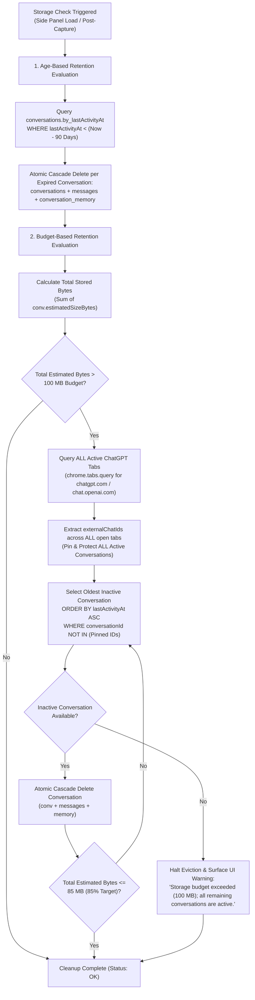
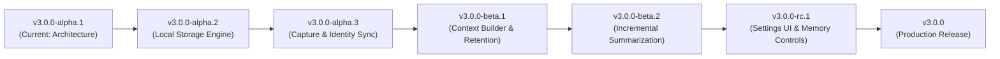

# WDAIDT v3.0.0-alpha.1 Architecture: Local Conversation Memory & Historical Context

**Milestone:** `v3.0.0-alpha.1`  
**Target Development Branch:** `feature/v3-conversation-memory`  
**Base Release:** `v2.1.0` (commit `cde84c7`)  
**Status:** Architecture Specification & Foundation (Documentation Only — Zero Runtime Feature Changes)  
**Date:** October 26, 2026 (Revised — Final Corrections)  

---

## 1. Executive Summary & Scope Boundary

WDAIDT V2.1.0 is a self-contained Chrome Manifest V3 browser extension providing real-time, evidence-based diagnostic explanations and follow-up prompts for ChatGPT responses. Analysis currently operates on an ephemeral interaction basis: when the user triggers analysis manually (**Why?**) or automatically (**Auto**), the content script extracts the latest exchange plus up to 10 preceding exchanges visible in the active ChatGPT DOM, passing them to Google's Gemini API (`gemini-3.5-flash-lite` with candidate fallbacks) or an offline deterministic Mock Analyzer.

**V3.0.0 Objective:** Introduce a privacy-preserving, production-grade **Local Conversation Memory System** powered by native browser IndexedDB. This system will persist conversation history locally, maintain compact incremental summaries, and supply rich historical context to the diagnostic analyzer even when ChatGPT virtualizes or unmounts older DOM turns.

### Scope Restrictions for `v3.0.0-alpha.1`:
- **Documentation-Only:** Define the architectural blueprint, storage schemas, identity reconciliation strategies, retention algorithms, context retrieval interfaces, and testing contracts.
- **Zero Runtime Behavior Alteration:** Do not implement IndexedDB runtime logic, modify existing content script extraction, change the Gemini analysis prompt or model configurations, or alter sidepanel runtime behavior in this stage.
- **Zero UI Redesign:** Do not redesign settings or add premature UI widgets in this stage.
- **No External Cloud / Backend:** Maintain 100% backend independence; all storage remains strictly on the user's local device in IndexedDB.
- **No Added Dependencies:** Do not introduce new production or development dependencies in this stage.
- **Version Integrity:** Keep manifest and runtime versions at `2.1.0`. Do not publish a release or create a version tag.

---

## 2. Current Architecture & Data-Flow Assessment

### 2.1 Component Breakdown & Implementation Facts

The following facts describe the verified V2.1.0 codebase:

```
[ ChatGPT Tab (chatgpt.com / chat.openai.com) ]
  │
  ├─ DOM MutationObserver (Auto-Analyze watcher, 2000ms debounce)
  └─ Content Script: src/content/chatgpt.js
       │  - 6-tier fallback extraction in chatScope():
       │      1. role-attributes ([data-message-author-role])
       │      2. message-id ([data-message-id])
       │      3. conversation-turns ([data-testid*="conversation-turn"])
       │      4. articles (main article, article)
       │      5. modern-turns (.markdown, .prose, .whitespace-pre-wrap, agent-turn, user-turn)
       │      6. content-blocks (structural text blocks inside main)
       │  - Shadow DOM piercing traversal (deepQuery)
       │  - Multi-turn exchange pairing (pairExchanges)
       │
       │ (Chrome Runtime Messaging: WDAIDT_GET_LATEST / WDAIDT_AUTO_ANALYZE_TRIGGER)
       ▼
[ Extension Side Panel: src/sidepanel/ ]
  ├─ Controller: app.js
  │    - Request orchestration & stale result guard (wdaidtIsStaleResult)
  │    - In-memory ephemeral interaction cache (lastCapture for Retry)
  │    - Safe DOM rendering (renderBlock, native textContent, zero innerHTML)
  │    - Context budgeting (filterContextExchanges: 0, 3, 5, 10 turns; max 30k chars)
  │    - Settings state & persistence (chrome.storage.local)
  │
  ├─ Shared Modules: src/shared/
  │    ├─ config.js: Endpoints, storage keys, limits (8k prompt, 20k response, 30k context)
  │    ├─ messages.js: Contract definitions (WDAIDT_MESSAGES)
  │    ├─ prompts.js: Master system prompt & passive XML packing (<CURRENT_INTERACTION>, <CONVERSATION_HISTORY>)
  │    ├─ validator.js: Request normalization & 9-block AnalysisDocument schema validation
  │    ├─ mock-analyzer.js: Hermetic offline analysis engine
  │    └─ gemini-client.js: Direct REST client (x-goog-api-key header auth, candidate fallback)
  │
  └─ Background Service Worker: src/background/service-worker.js
       - Side panel action click routing & initial default setting bootstrap
```

### 2.2 Trace of Existing Runtime Flows

1. **Manual Analysis ("Why?"):**
   - User clicks `whyBtn` in `app.js`.
   - `captureLatest()` queries the active tab and sends `WDAIDT_GET_LATEST` to `chatgpt.js`.
   - `chatgpt.js` runs `getLatestInteraction()`, scanning DOM nodes in `chatScope()` across the 6 extraction strategies.
   - `pairExchanges()` isolates the latest user message and trailing assistant reply, bundling all preceding completed exchanges into `res.history`.
   - `app.js` receives payload, applies character trimming (`trimForBackend`: 8k prompt, 20k response), filters history via `filterContextExchanges` according to `settingsState.contextWindow` (default 5 turns, max 30,000 characters), and caches the exchange in memory as `lastCapture`.
   - `analyzeCapture()` dispatches payload to `postAnalyze()`. In Mock Mode, `mock-analyzer.js` produces deterministic blocks; in Live Mode, `gemini-client.js` executes an HTTPS POST to Google's Generative Language API.
   - Response passes through `cleanJsonText()`, `validateAnalysisDocument()`, and is rendered via safe DOM manipulation (`renderBlock()`).

2. **Auto-Analyze Workflow:**
   - User enables the `autoToggle` switch, persisting `wdaidt_auto_analyze: true` to `chrome.storage.local`.
   - `chatgpt.js` receives `WDAIDT_AUTO_ANALYZE_ON`, arms a `MutationObserver` on `document.documentElement` / `document.body`.
   - When ChatGPT streams a reply, continuous DOM mutations reset `autoSchedule()`.
   - Once mutations settle for `AUTO_DEBOUNCE_MS` (2,000 ms), `autoCheck()` captures the latest exchange.
   - If the exchange is complete (`paired: true`) and its fingerprint hash differs from `lastNotifiedHash`, it fires `WDAIDT_AUTO_ANALYZE_TRIGGER` to `chrome.runtime.sendMessage()`.
   - `app.js` debounces runtime messages by 500 ms and executes `runAuto()`.

3. **Retry Workflow:**
   - If an analysis request fails due to transient network interruption, API rate limiting, or invalid configuration, `showError()` reveals the `retryBtn`.
   - `lastCapture` remains cached in memory in `app.js`. Clicking **Retry** invokes `runRetry()`, immediately re-submitting `lastCapture` and its normalized context without refocusing the tab or re-reading the DOM.

### 2.3 Verified Memory Deficiencies in V2.1.0

1. **Ephemeral Interaction Cache:** `lastCapture` and `history` exist strictly in volatile window memory in `app.js`. Closing the side panel, reloading the page, or switching browser tabs discards captured exchanges.
2. **DOM Virtualization Blind Spot:** Modern Single-Page Applications (SPAs) like ChatGPT aggressively virtualize long threads, unmounting earlier DOM turns to conserve memory. Once unmounted from the DOM, earlier exchanges cannot be captured by `pairExchanges()`.
3. **Mid-Thread Evaluation Gaps:** When a user opens WDAIDT midway through a long thread (e.g. at turn 15), WDAIDT only sees the turns currently rendered in the DOM, with zero access to earlier constraints, previous diagnostic insights, or original setup requirements.
4. **Lack of Cumulative Memory:** The current context window (`filterContextExchanges`) simply passes raw prior exchanges verbatim up to 30,000 characters. As conversations grow, older exchanges are dropped completely, with no synthesis, key constraint tracking, or cumulative understanding.

---

## 3. Proposed IndexedDB Architecture

To overcome ephemeral limits without compromising privacy or introducing external servers, WDAIDT v3 will introduce a dedicated local database using native browser IndexedDB.

### 3.1 Database Identity & Versioning
- **Database Name:** `wdaidt_local_db`
- **Initial Version:** `1`
- **Execution Context:** The sidepanel and background contexts share origin access (`chrome-extension://<EXTENSION_ID>`). All write transactions will be managed by a centralized, robust storage module (`src/shared/db.js`).

### 3.2 Object Store Specifications

#### 1. `conversations` Store
Stores conversation session metadata, identity resolution state, and capture completeness.

- **Primary Key:** `conversationId` (string, UUIDv4 generated locally)
- **Fields:**
  - `conversationId` (string, PK): Stable internal identifier.
  - `platform` (string): Always `'chatgpt'` for Manifest V3 scope.
  - `externalChatId` (string | null): The ChatGPT conversation UUID extracted from URL (`/c/:id`) or DOM. `null` for new chats before the first response.
  - `identityStatus` (string): Enum `['provisional', 'resolved']`.
    - `'provisional'`: Chat originated on `/` without an external chat UUID. `externalChatId` is `null`.
    - `'resolved'`: Associated with a verified `externalChatId` from URL or DOM.
  - `completenessStatus` (string): Enum `['head_only', 'partial', 'complete']`.
    - `'head_only'`: Only the latest exchange was observed (single-turn capture with no preceding turns).
    - `'partial'`: Multiple turns were captured, but tracking began mid-conversation, or earlier DOM nodes were unmounted/virtualized, or history continuity cannot be verified back to Turn 0.
    - `'complete'`: Continuous observation verified from initial prompt (Turn 0) without gaps or missing turns.
  - `title` (string | null): Conversation title (captured from DOM navigation header/sidebar or derived from prompt 1).
  - `createdAt` (number): Unix epoch millisecond timestamp of conversation discovery.
  - `lastActivityAt` (number): Unix epoch millisecond timestamp of the latest captured exchange or analysis.
  - `lastCapturedMessageId` (string | null): Foreign key to the latest captured message in `messages`.
  - `messageCount` (number): Exact integer tally of messages stored under this conversation.
  - `totalCharacterCount` (number): Exact integer tally of characters across all stored messages and summary.
  - `estimatedSizeBytes` (number): Approximate byte footprint of conversation records, messages, and summary.
  - `summaryRevision` (number): Monotonic revision integer of the active summary (`0` if unsummarized).
  - `summaryUpdatedAt` (number | null): Timestamp of last summary update.
- **Indexes:**
  - `by_externalChatId`: Key path `['platform', 'externalChatId']`, `unique: false`. Allows fast lookup when URL transitions to a permanent chat ID.
  - `by_lastActivityAt`: Key path `'lastActivityAt'`, `unique: false`. Used for LRU retention and cleanup ordering.
  - `by_identityStatus`: Key path `'identityStatus'`, `unique: false`. Supports discovery of pending provisional records.
  - `by_completenessStatus`: Key path `'completenessStatus'`, `unique: false`. Facilitates capture audits.

> [!IMPORTANT]
> **Identity Resolution vs. Capture Completeness:**  
> A URL acquiring a stable ChatGPT ID resolves identity (`identityStatus: 'resolved'`), but **must never** mark `completenessStatus` as `'complete'`. A conversation can have a resolved external ID while remaining `'partial'` or `'head_only'`.

#### 2. `messages` Store
Stores the full-fidelity record of each captured user prompt and assistant response.

- **Primary Key:** `messageId` (string, UUIDv4 generated locally)
- **Fields:**
  - `messageId` (string, PK): Stable internal message identifier.
  - `conversationId` (string, FK): Reference to parent `conversations.conversationId`.
  - `sourceMessageId` (string | null): ChatGPT DOM `data-message-id` attribute when available; `null` otherwise. (DOM selectors do not reliably expose permanent message IDs across layout updates, so this is an opportunistic hint, never a required key).
  - `role` (string): `'user'` | `'assistant'`.
  - `segmentId` (number): Integer identifying the contiguous capture segment (starts at `0`; incremented if capture detects an unanchored gap or unmounted history break).
  - `turnSequence` (number): Strict 0-indexed monotonic integer representing chronological position within `segmentId`.
  - `orderConfidence` (string): Enum `['verified_continuous', 'gap_discontinuous', 'order_uncertain']`.
  - `content` (string): Complete captured text, preserving formatting, whitespace, code blocks, and markdown.
  - `contentHash` (string): Cryptographic SHA-256 or fast 32-bit hash of normalized content used strictly for change/diff detection, **never** as the sole message identifier.
  - `revisionNumber` (number): Monotonic integer starting at `1`, incremented on response regeneration or prompt edit.
  - `auditMetadata` (object | null): `{ previousContentHash: string, lastEditedAt: number, revisionCount: number }` tracking change history.
  - `sourceTimestamp` (number | null): Creation timestamp if exposed by DOM attributes; `null` if unavailable.
  - `capturedAt` (number): Local timestamp when WDAIDT captured the message.
  - `characterCount` (number): Exact character count of `content`.
  - `estimatedSizeBytes` (number): Estimated byte footprint (`content.length * 2` + metadata).
  - `captureStatus` (string): Enum `['complete', 'streaming', 'partial']`.
- **Indexes:**
  - `by_conversationId`: Key path `'conversationId'`, `unique: false`. Fetch all messages in a conversation.
  - `by_conv_segment_seq`: Key path `['conversationId', 'segmentId', 'turnSequence']`, `unique: true`. Guarantees order within a contiguous segment while preventing constraint crashes across unanchored gaps.
  - `by_conv_sequence`: Key path `['conversationId', 'turnSequence']`, `unique: false`. Supports global sequential cursor scans across segments.
  - `by_conv_sourceId`: Key path `['conversationId', 'sourceMessageId']`, `unique: false`. Facilitates DOM ID reconciliation when present.
  - `by_capturedAt`: Key path `'capturedAt'`, `unique: false`. Supports global age-based retention queries.
  - `by_conv_capturedAt`: Key path `['conversationId', 'capturedAt']`, `unique: false`. Supports scoped range queries.

#### 3. `conversation_memory` Store
Stores compact, incremental conversational summaries and extracted constraints. Summaries are strictly derived artifacts and never replace original messages.

- **Primary Key:** `conversationId` (string, PK, 1:1 relationship with `conversations`)
- **Fields:**
  - `conversationId` (string, PK): Reference to parent conversation.
  - `schemaVersion` (number): Schema version of the summary structure (e.g. `1`).
  - `summaryRevision` (number): Monotonic integer incremented on each successful summary update.
  - `sourceMessageCheckpoint` (object): Snapshot of source coverage:
    - `maxSegmentId` (number): Highest segment incorporated.
    - `maxTurnSequence` (number): Highest message sequence synthesized.
    - `sourceMessageCount` (number): Exact count of messages incorporated.
    - `headContentHash` (string): Hash of the latest source message at generation time.
  - `generationId` (string | null): UUID identifying the active in-flight generation task.
  - `status` (string): Enum `['idle', 'generating', 'ready', 'stale', 'failed']`.
  - `updatedAt` (number): Timestamp of latest summary generation.
  - `retryCount` (number): Sequential retry attempts for summary generation.
  - `lastError` (string | null): Error message if summary generation failed.
  - `compactSummary` (string): Structured, concise narrative (approx. 500–1,500 characters) detailing objectives, established solutions, and topic evolution.
  - `activeTopics` (string[]): Array of short topic tags (e.g. `["quicksort", "memory safety", "C99"]`).
  - `constraints` (string[]): Explicit user constraints extracted from history (e.g. `["no third-party libraries", "target POSIX compliant"]`).
  - `characterCount` (number): Exact character count of `compactSummary`.
  - `estimatedSizeBytes` (number): Memory footprint of summary record.
- **Indexes:**
  - `by_updatedAt`: Key path `'updatedAt'`, `unique: false`.
  - `by_status`: Key path `'status'`, `unique: false`.

### 3.3 Transaction Boundaries & Concurrency Guarantees

> [!CRITICAL]
> **Transaction Segregation Invariant:**  
> IndexedDB transactions **must never** be held open while waiting on Google Gemini API calls or external asynchronous tasks. In browser JavaScript engines, an open IndexedDB transaction auto-commits as soon as the microtask queue clears without a queued IDB request. All database operations must be divided into discrete, synchronous-boundary transactions:
> 1. **Read Phase Transaction (`readonly`):** Read source messages and prior summary checkpoint.
> 2. **Network / Processing Phase (Zero IDB Transaction):** Execute external Gemini API call or local mock generation.
> 3. **Commit Phase Transaction (`readwrite`):** Open a fresh write transaction, verify concurrency checkpoints, and commit updates atomically.

- **Atomic Interaction Capture:** When storing a captured interaction (user prompt + assistant response), a single `readwrite` transaction spans `['conversations', 'messages']`.
- **Atomic Cascade Erasure:** Deleting a conversation, its messages, and its summary occurs in a single `readwrite` transaction spanning `['conversations', 'messages', 'conversation_memory']`.
- **Source of Truth Invariant:** Original message text in `messages` is immutable by summarization. Summaries are strictly derived and can be regenerated or dropped without corrupting message history.

---

## 4. Message Identity, Revisions & Capture Recovery

ChatGPT DOM structures evolve frequently, and message identity cannot rely on a single attribute or naive string matching.

### 4.1 URL Dynamics & Transactional Provisional Reconciliation

When a user initiates a new chat at `https://chatgpt.com/`, the initial exchange occurs before a permanent chat UUID exists in the URL.

```
[ New Chat Initial State: URL = "https://chatgpt.com/" ]
  │
  ├─ User enters prompt -> Assistant streams reply.
  ├─ WDAIDT captures interaction:
  │    - Generate internal conversationId: UUIDv4
  │    - externalChatId: null
  │    - identityStatus: 'provisional'
  │    - completenessStatus: 'head_only' (or 'partial' if multi-turn)
  │    - Messages stored with segmentId = 0, turnSequence = 0, 1...
  │
[ ChatGPT Navigation State: URL updates via pushState to "/c/:uuid" ]
  │
  ├─ Content script or Side Panel detects URL transition to externalChatId = ":uuid"
  │
  ▼
[ Atomic Reconciliation Transaction (readwrite over ['conversations', 'messages', 'conversation_memory']) ]
  │
  ├─ Query conversations.by_externalChatId for ":uuid"
  │
  ├─ CASE 1: No existing conversation record found
  │    ├─ Promote provisional record: set externalChatId = ":uuid", identityStatus = 'resolved'
  │    └─ DO NOT modify completenessStatus (keeps existing 'head_only' or 'partial')
  │
  └─ CASE 2: Existing conversation record ALREADY found (e.g. multi-tab or pre-existing thread)
       ├─ Candidate Turn Matching (Section 4.2)
       ├─ Collision Resolution & Segmentation (Section 4.3)
       ├─ Reconcile exact messageCount, totalCharacterCount, estimatedSizeBytes
       ├─ Update lastActivityAt = max(existing.lastActivityAt, provisional.lastActivityAt)
       ├─ Mark conversation_memory status = 'stale'
       └─ Delete provisional conversation record and its moved message rows within the SAME transaction
```

### 4.2 Multi-Tier Message Identity Matrix

| Scenario | Identifier Strategy | Change Detection | Handling Policy |
| :--- | :--- | :--- | :--- |
| **DOM exposes `data-message-id`** | Opportunistic `sourceMessageId` combined with parent `conversationId` | `contentHash` comparison against existing record | If `contentHash` matches, ignore duplicate observation. If `contentHash` differs, apply In-Place Revision Update (Section 4.4). |
| **DOM lacks `data-message-id` (Strategy 3–6)** | Position anchor: preceding turn anchor + `role` | Relative DOM ordering in `chatScope()` combined with role | Assign monotonic `turnSequence` in active `segmentId`. |
| **Identical Text in Separate Messages** | Unique `messageId` + distinct position/timestamp | Distinct position in thread | **Never deduplicate purely by content hash.** Legitimate repeated user inputs (e.g. "yes", "continue") receive distinct message records and distinct turn sequence slots. |
| **Edited User Prompt** | Matched by sequence position & role | `contentHash` differs from existing record | Apply In-Place Revision Update: update `content`, increment `revisionNumber`, record audit metadata, mark summary `'stale'`. |
| **Regenerated Assistant Response** | Matched by sequence position & role `'assistant'` | In `chatgpt.js`, `pairExchanges()` always selects the last assistant node after the prompt (`turnAssts[turnAssts.length - 1]`) | Apply In-Place Revision Update: update `content`, increment `revisionNumber`, record audit metadata, mark summary `'stale'`. |
| **Incomplete Streaming Response** | Flagged as `captureStatus: 'streaming'` | Content script skips empty nodes during streaming. Auto-analyze enforces `AUTO_DEBOUNCE_MS = 2000ms`. | Only settled, complete exchanges (`paired: true`) trigger persistent summary updates. Mid-stream captures remain marked `'streaming'`. |
| **SPA Navigation Between Chats** | URL change detection (`location.href`) | Side panel tracks active tab URL on each capture | Active conversation context switches immediately to the matching `externalChatId`. |
| **Mid-Thread Discovery (Partial Capture)** | Flagged as `completenessStatus: 'partial'` | Tracking began without Turn 0 or DOM turns were unmounted | Record explicitly captured range starting at observed turn offset. Never invent or backfill unobserved past turns. |

### 4.3 Deterministic Sequence Collision Resolution Policy

When merging a provisional conversation into an existing conversation with the same `externalChatId`, sequence conflicts could occur if both stores contain turns with sequence numbers `0, 1...`.

To resolve this deterministically without crashing compound indexes or inventing false chronology:

1. **Segmented Sequencing Isolation:**
   - The unique compound index is `by_conv_segment_seq: ['conversationId', 'segmentId', 'turnSequence']`.
   - The secondary index `by_conv_sequence: ['conversationId', 'turnSequence']` is `unique: false`.
2. **Anchor Matching:**
   - If the provisional messages share verified anchor turns (e.g. matched `sourceMessageId` or verified `(role, contentHash)` sequence) with existing messages in `segment K`, new trailing turns are appended to `segment K` with `turnSequence = maxTurnSequence + 1`.
3. **Unanchored Gap Handling (Zero Invented Chronology):**
   - If the provisional capture observed turns that cannot be anchored to existing turns (e.g. due to ChatGPT unmounting/virtualizing turns between the stored history and the newly observed tail):
     - The provisional messages are assigned `segmentId = existingMaxSegment + 1`.
     - `orderConfidence` is marked `'gap_discontinuous'`.
     - `turnSequence` starts at `0` within the new segment.
   - **Guarantees:**
     - **No Constraint Crash:** The compound index `['conversationId', segmentId, turnSequence]` guarantees uniqueness without collision.
     - **Zero Dropped Data:** Every distinct message is preserved intact.
     - **Truthful Chronology:** WDAIDT does not guess how many unmounted turns were skipped between Segment 0 and Segment 1.
4. **Idempotence & Retry Safety:**
   - The entire reconciliation runs in a single `readwrite` transaction. If interrupted, neither record is partially modified. If retried, checking for the provisional ID cleanly no-ops if already merged.

### 4.4 In-Place Revision Replacement Policy & Privacy Rationale

When a user edits an earlier prompt or clicks "Regenerate response" in ChatGPT:

1. **In-Place Update:** The existing message record's `content` is updated in place.
2. **Revision Tracking:** `revisionNumber` is incremented by `1`, `contentHash` is recomputed, and `auditMetadata` stores `{ previousContentHash: string, lastEditedAt: number, revisionCount: number }`.
3. **Discard Superseded Raw Text:** Prior raw text drafts of superseded turns are discarded rather than retained as perpetual historical rows.
4. **Summary Invalidation:** Any summary in `conversation_memory` covering that turn is marked `status = 'stale'`.
5. **Privacy and Retention Rationale:**  
   Users edit prompts or regenerate answers specifically to retract or correct earlier output (which may contain accidental PII, credentials, or erroneous code). Retaining unbounded historical text drafts of superseded turns introduces privacy risks, complicates data deletion guarantees, and causes uncontrolled local storage growth. Storing active text with audit metadata maintains an accurate thread representation while respecting user editing intent.

---

## 5. Storage Accounting, Retention, and Cleanup Algorithm

To prevent unbounded disk consumption while respecting Chrome extension storage dynamics, WDAIDT implements a dual-mode retention engine: **Age-Based Expiration** and **Budget-Based LRU Eviction**.

### 5.1 Storage Preferences & Default Constants
- `DEFAULT_STORAGE_BUDGET_BYTES`: `104,857,600` (100 MB target policy limit)
- `DEFAULT_RETENTION_DAYS`: `90` (90 days maximum inactivity age)
- `CLEANUP_HYSTERESIS_RATIO`: `0.85` (Evict down to 85% of budget [85 MB] to prevent thrashing)
- `SUMMARY_ENABLED`: `true`

> [!IMPORTANT]
> **Application Policy vs. Chrome Quota:**  
> The 100 MB budget is a user-configurable extension management policy, not a physical hardware constraint or hard Chrome quota guarantee. Chrome allocates storage per origin based on total disk availability. Storage usage is tracked using calculated byte estimates (`estimatedSizeBytes`) supplemented by `navigator.storage.estimate()` where supported.

### 5.2 Exact Metrics vs. Size Estimates

- **Exact Metrics (Deterministic):**
  - `messageCount`: Exact integer count of stored message records.
  - `characterCount`: Exact sum of UTF-16 code units across prompt, response, and summary strings.
- **Estimated Sizes (Approximations):**
  - `estimatedSizeBytes`: Estimated byte footprint on disk:
    $$\text{estimatedSizeBytes} = (\text{characterCount} \times 2) + (\text{record count} \times 128 \text{ bytes metadata})$$
  - Discerned as an estimate because V8 in-memory representation, IndexedDB LevelDB/SQLite block compression, and B-tree indexing overhead vary by operating system and Chrome release.

### 5.3 Totals Reconciliation After Operations

To prevent metadata drift, totals are updated in the same write transaction as the operation:
- **Message Edit / Regeneration:** `conv.totalCharacterCount += (newChars - oldChars); conv.estimatedSizeBytes += (newBytes - oldBytes)`.
- **Summary Update:** `conv.totalCharacterCount += (newSummaryChars - oldSummaryChars)`.
- **Cascade Deletion:** Conversation totals are subtracted from global tally; on transaction completion, stores are cleanly updated.
- **Interrupted Transactions:** IndexedDB transactions roll back automatically on failure, preserving exact metadata consistency.
- **Startup Integrity Audit:** On extension startup or sidepanel initialization, a fast indexed cursor audit recalculates global counts if an ungraceful browser crash was flagged.

### 5.4 Retention & Cleanup Workflow



### 5.5 Critical Retention Edge Cases & Safety Guarantees

1. **Inactivity Age vs. Message Age:** Expiration evaluates `conversations.lastActivityAt` (inactivity age), not individual message age. If a conversation started 120 days ago was active yesterday, its inactivity age is 1 day; the entire conversation remains preserved intact. Messages are never sliced out from underneath a summary.
2. **Multiple Open ChatGPT Tabs:** Protection inspects all open ChatGPT tabs across all browser windows. Every conversation currently open in any ChatGPT tab is pinned and protected from budget LRU eviction.
3. **Exhaustion of Inactive Data:** If all inactive conversations have been evicted and storage still exceeds 100 MB due to active conversations, **WDAIDT will never silently drop turns or delete active conversation data.** It halts cleanup and surfaces an informational warning in settings.
4. **Interrupted Cleanup Recovery:** Deletion operates conversation-by-conversation. Each cascade delete is an atomic transaction. If interrupted, already deleted conversations stay deleted, and remaining conversations are cleanly evaluated on the next run.
5. **In-Flight Summary Race on Deleted Conversation:** If a conversation is evicted or manually deleted while a Gemini summarization call is in flight, the commit phase transaction (Section 3.3) looks up `conversations.conversationId`, finds it missing, and safely discards the returned summary.

---

## 6. Historical Context Retrieval Strategy

The context retrieval engine bridges stored historical memory and the live diagnostic analyzer without overflowing LLM token windows or exhausting memory.

### 6.1 Composite Context Window Architecture

```
┌────────────────────────────────────────────────────────────────────────┐
│                        Gemini Analysis Request                         │
├────────────────────────────────────────────────────────────────────────┤
│ 1. Master System Prompt (prompts.js)                                  │
│    - Diagnostic principles, omission focus, anti-summarization rules    │
│    - User style & depth preferences                                    │
├────────────────────────────────────────────────────────────────────────┤
│ 2. Conversation Memory Summary (<CONVERSATION_MEMORY>)                  │
│    - Injected ONLY when historical turns precede the recent window     │
│    - Compact technical synthesis (approx. 500-1,500 characters)         │
│    - Explicit constraints & topics established in earlier exchanges    │
├────────────────────────────────────────────────────────────────────────┤
│ 3. Recent Conversation History (<CONVERSATION_HISTORY>)                │
│    - Last N complete exchanges (configured: 0, 3, 5, or 10 turns)      │
│    - Chronological raw dialogue format: [Exchange K] User / Assistant │
├────────────────────────────────────────────────────────────────────────┤
│ 4. Current Interaction (<CURRENT_INTERACTION>)                         │
│    - Target User Prompt (<USER_PROMPT>)                                │
│    - Target AI Response (<AI_RESPONSE>)                                │
└────────────────────────────────────────────────────────────────────────┘
```

### 6.2 Context Sizing & Character Budget Allocation
The existing V2 context budget allows up to 30,000 characters for context, with prompt maximum 8,000 chars and response maximum 20,000 chars (40,000 characters max acceptance in `validator.js`).

V3 enforces strict budget allocation:
- **Current Exchange:** Uncompromised priority (up to 8,000 chars prompt + 20,000 chars response).
- **Conversation Memory Summary:** Capped at `3,000` characters. Provides high-level grounding for earlier exchanges.
- **Recent Raw Exchanges:** Fills remaining context budget (up to `27,000` characters) selecting the most recent turns in reverse chronological order, dropping older complete exchanges if budget is exceeded.

### 6.3 Database Query Efficiency (RAM Protection)
- Retrieval does **not** load the entire conversation history into memory.
- Query uses `IDBKeyRange.bound([convId, minSeq], [convId, maxSeq])` to fetch only the required recent exchanges.
- The summary record is fetched by direct primary key lookup (`conversations.conversationId`).

### 6.4 Preservation of Analysis Contract
- The backend/Gemini request contract remains `postAnalyze(prompt, response, requestId, context)`.
- When conversation memory is present, `context` items retain their standard schema (`{ prompt, response }`), and `prompts.buildAnalysisUserPrompt` safely incorporates the `<CONVERSATION_MEMORY>` block before `<CONVERSATION_HISTORY>`.
- **Epistemic Modesty Rule:** WDAIDT must make clear that conversation memory is an analytical aid for WDAIDT. It does **not** imply that ChatGPT's internal transformer context has been modified.

---

## 7. Gemini Summary Updates: Lifecycle & Failure Handling

Compact summaries allow WDAIDT to remember decisions across long sessions without exceeding context size limits.

### 7.1 Incremental Summary Lifecycle & State Machine

```
              ┌────────────────────────┐
              │ Turn Captured & Settled│
              └───────────┬────────────┘
                          │ Unsummarized turns >= BATCH_THRESHOLD (e.g. 3 turns / 5k chars)
                          ▼
              ┌────────────────────────┐
              │ Transaction 1: Read    │ Fetch target messages & prior summary checkpoint
              └───────────┬────────────┘
                          │ Record generationId = UUIDv4; set status = 'generating'
                          ▼
              ┌────────────────────────┐
              │ External Async Call    │ (Zero IDB transaction held open)
              │ Gemini API / Mock Mode │
              └───────────┬────────────┘
                          │
         ┌────────────────┴────────────────┐
         │ API Success                     │ Network / API Failure
         ▼                                 ▼
┌─────────────────────────────────┐      ┌─────────────────────────────────┐
│ Transaction 2: Commit Phase     │      │ Transaction 2: Failure Phase    │
│  - Verify generationId matches  │      │  - Set status = 'failed'        │
│  - Check headContentHash        │      │  - Increment retryCount         │
│  - Validate output schema       │      │  - Retain prior summary intact  │
└────────┬────────────────────────┘      └─────────────────────────────────┘
         │ Checkpoints match
         ▼
┌─────────────────────────────────┐
│ Set status = 'ready'            │
│ Increment summaryRevision       │
│ Persist to conversation_memory  │
└─────────────────────────────────┘
```

### 7.2 Summary Prompt Specification
Summarization runs against Google's Generative Language API using a compact, structured instruction prompt:
- **Role:** Interaction summarizer extracting technical objectives, key constraints established, decisions confirmed, and pending follow-ups.
- **Constraints:** Max 1,500 characters, no conversational fluff, no meta-commentary, output strictly valid JSON matching schema:
  ```json
  {
    "summary": "Concise chronological synthesis of technical progress and decisions...",
    "activeTopics": ["topic1", "topic2"],
    "constraints": ["constraint1", "constraint2"]
  }
  ```

### 7.3 Concurrency Control & Stale Overwrite Protection

1. **Checkpoint Verification:** When a generation task starts, it records `generationId` and `sourceMessageCheckpoint: { maxSegmentId, maxTurnSequence, sourceMessageCount, headContentHash }`.
2. **Rejection of Delayed Responses:** In the Commit Phase write transaction, the returned payload is rejected if:
   - The active record's `generationId` no longer matches the response's `generationId`.
   - The message at `(maxSegmentId, maxTurnSequence)` has a different `contentHash` (indicating an intervening edit or regeneration).
   - Any intervening message deletion occurred.
3. **Monotonic Revision Protection:** An older summary generation task that finishes late can never overwrite a newer `summaryRevision`.
4. **Preservation on Failure:** If the Gemini API call fails, times out, or returns invalid JSON, `status` is set to `'failed'`, `retryCount` increments, and the existing valid `compactSummary` is completely preserved.

### 7.4 Hermetic Mock Mode Separation
- When `wdaidt_mock_mode: true` is enabled, summary generation bypasses `gemini-client.js` entirely.
- A dedicated deterministic mock summarizer (`generateMockSummary()`) synthesizes topic tags and constraint lists based on observable lexical tokens, requiring zero network calls and zero API keys.

---

## 8. Security and Privacy Requirements

### 8.1 Local-First Privacy Policy
- All raw dialogue turns, message timestamps, turn sequences, and compact summaries are stored exclusively on the user's local device in IndexedDB.
- No interaction history is ever synced to third-party cloud databases, telemetry services, or WDAIDT servers.

### 8.2 Transparent Transmission Disclosure
- User messages are transmitted externally **only** when an active analysis is performed, connecting directly from the extension to `https://generativelanguage.googleapis.com` via the user's own API key.
- The UI must clearly indicate that live analyses transmit selected conversation context to Google under the Google AI terms of service.

### 8.3 Zero-Credential Ingress Invariant
- Google Gemini API keys (`wdaidt_gemini_api_key`) are stored strictly in `chrome.storage.local`.
- API keys are **never** stored in IndexedDB tables, embedded in conversation records, included in prompt dumps, or output to console logs.

### 8.4 User Deletion & Erasure Rights
- **Single Conversation Erasure:** Users can delete an individual conversation, which cascades to delete all associated messages and summaries immediately.
- **Global Wipe ("Clear All Memory"):** A single action purges the entire IndexedDB database (`indexedDB.deleteDatabase('wdaidt_local_db')`), resetting storage to zero.
- **Standard Extension Lifecycle:** Removing the extension from Chrome automatically triggers browser profile deletion of all associated IndexedDB and `chrome.storage.local` data.

### 8.5 Epistemic & Cryptographic Honesty
- WDAIDT will **not** claim "end-to-end encryption" or "military-grade database encryption." Storage is protected by Chrome's process isolation and operating system file-system security for the user profile.

---

## 9. Comprehensive Testing Strategy

WDAIDT maintains a zero-regression mandate. All tests must be runnable using the repository's verified test environment:
```powershell
node --test tests/extension/*.test.js
```

### 9.1 Verified Existing Test Baseline
On October 26, 2026, the test suite was independently executed and verified in the active environment from repository root:
- **Exact Command:** `node --test tests/extension/*.test.js`
- **Runner Summary:** `ℹ tests 166`, `ℹ suites 0`, `ℹ pass 166`, `ℹ fail 0`, `ℹ cancelled 0`, `ℹ skipped 0`, `ℹ todo 0`, `ℹ duration_ms 1083.5`
- **Discovered Test Files:** 14 test files discovered and executed:

| Test File | Discovered & Passed Tests | Status |
| :--- | :--- | :--- |
| `tests/extension/auto.test.js` | 6 tests | Pass |
| `tests/extension/capture.test.js` | 31 tests | Pass |
| `tests/extension/capture_audit.test.js` | 8 tests | Pass |
| `tests/extension/context.test.js` | 23 tests | Pass |
| `tests/extension/day1.smoke.test.js` | 6 tests | Pass |
| `tests/extension/gemini_client.test.js` | 17 tests | Pass |
| `tests/extension/integration.test.js` | 12 tests | Pass |
| `tests/extension/integration_v2.test.js` | 9 tests | Pass |
| `tests/extension/mock_analyzer.test.js` | 8 tests | Pass |
| `tests/extension/pipeline.test.js` | 4 tests | Pass |
| `tests/extension/prompts.test.js` | 9 tests | Pass |
| `tests/extension/renderer.test.js` | 14 tests | Pass |
| `tests/extension/settings.test.js` | 5 tests | Pass |
| `tests/extension/validator.test.js` | 14 tests | Pass |
| **Total** | **166 passed / 0 failed / 0 skipped** | **100% Pass** |

### 9.2 Multi-Tier Test Architecture

Because Node.js does not expose a global `window.indexedDB`, the testing strategy is structured across three distinct tiers:

```
┌────────────────────────────────────────────────────────────────────────┐
│ Tier 1: In-Memory Fast Unit Tests (Node.js Built-in Test Runner)       │
│ - Uses hermetic mock storage adapter matching db.js interface         │
│ - Verifies accounting formulas, reconciliation logic, context builder,  │
│   summary state transitions, and revision replacement rules           │
├────────────────────────────────────────────────────────────────────────┤
│ Tier 2: Real IndexedDB Transaction & Schema Tests (Node.js + Shim)     │
│ - Evaluates actual IDBKeyRange bounds, transaction auto-commit rules,  │
│   and compound index constraints                                       │
│ - Tooling Plan: Propose dev-only test shim (fake-indexeddb) in alpha.2 │
│   (Requires explicit approval before adding to package.json)           │
├────────────────────────────────────────────────────────────────────────┤
│ Tier 3: Real Browser Extension Integration Tests (Chromium Headless)   │
│ - Real Chrome extension environment running sidepanel & content script │
│ - Verifies true disk persistence across simulated service-worker drops │
│ - Planned for milestone v3.0.0-rc.1                                    │
└────────────────────────────────────────────────────────────────────────┘
```

### 9.3 Planned Test Suites & Coverage Targets (Future Milestones)

| Test Suite File | Responsibility & Scenario Coverage |
| :--- | :--- |
| `tests/extension/db_schema.test.js` | Database initialization, schema creation, store definitions, index verification, version upgrade handling. |
| `tests/extension/db_crud.test.js` | Atomic insertion of conversations and messages, sequential turn queries, key constraints, cascade deletion. |
| `tests/extension/message_identity.test.js` | Deduplication of repeated DOM observations, handling identical message text across separate turns, edited prompts, and regenerated responses. |
| `tests/extension/reconciliation.test.js` | Transactional merge of provisional conversation on `/` when URL transitions to `/c/:id`, duplicate turn protection, gap handling. |
| `tests/extension/retention_age.test.js` | Inactivity age calculation, expiration of 90+ day old conversations, preservation of active conversations with mixed-age turns. |
| `tests/extension/retention_budget.test.js` | Exact character tallies vs. size estimates, 100 MB budget LRU eviction, multi-tab active conversation protection. |
| `tests/extension/context_retrieval.test.js` | Composite context assembly (Summary + History + Current), strict character limit enforcement (30k/40k bounds), bounded range queries. |
| `tests/extension/summary_lifecycle.test.js` | 3-phase transaction lifecycle, optimistic concurrency guards, rejection of stale delayed responses, failure recovery. |
| `tests/extension/mock_memory.test.js` | Hermetic offline mock summarization, deterministic output validation, zero network calls in Mock Mode. |
| `tests/extension/privacy_erasure.test.js` | Single conversation purge, total database wipe verification, confirmation of zero API key leaks in stored records. |
| `tests/extension/regression_v2.test.js` | Continuous validation that all existing 166 tests continue to pass without deviation. |

### 9.4 Acceptance Status for Milestone v3.0.0-alpha.1
- [x] **Verified by Execution:** Existing release `v2.1.0` (commit `cde84c7`) test baseline verified: exactly 166 automated tests pass under `node --test tests/extension/*.test.js` with 0 failures.
- [x] **Verified by Inspection:** Branch `feature/v3-conversation-memory` cleanly branched from `main` without uncommitted drift.
- [x] **Verified by Inspection:** Architectural review findings resolved in `docs/V3.0.0-ALPHA.1-ARCHITECTURE.md`.
- [x] **Verified by Inspection:** Zero runtime code or behavior modified in `extension/`.
- [x] **Verified by Inspection:** Zero dependencies or cloud backends introduced.
- [ ] *Planned for Future Milestones (Not Verified in Alpha.1):* IndexedDB runtime storage engine, capture integration, summarizer modules, and settings UI controls (deferred to milestones `v3.0.0-alpha.2` through `v3.0.0-rc.1`).

---

## 10. Coherent Implementation Roadmap

The implementation sequence progresses cleanly through disciplined alpha, beta, and release candidate stages:



1. **Milestone `v3.0.0-alpha.1`: Foundation & Architecture (Current Stage)**
   - Technical inspection, architectural documentation, and interface specifications.
   - Zero runtime code changes; zero test changes; zero new dependencies.

2. **Milestone `v3.0.0-alpha.2`: Local Storage Engine**
   - Implement `extension/src/shared/db.js` providing native IndexedDB initialization, transactional CRUD wrappers, exact metric tracking, segmented sequencing, and error handling.
   - Author storage unit tests (`tests/extension/db_*.test.js`) under `node --test`.
   - Submit formal proposal for dev-only test shim (`fake-indexeddb`).

3. **Milestone `v3.0.0-alpha.3`: Capture & Identity Reconciliation**
   - Integrate `db.js` into sidepanel capture flow (`app.js`).
   - Implement transactional provisional reconciliation and multi-tier message identity handling.
   - Verify deduplication of streaming mutations and regenerated turns.

4. **Milestone `v3.0.0-beta.1`: Historical Context Builder & Retention Engine**
   - Implement composite context retrieval combining stored history with active captures.
   - Implement age-based and budget-based LRU retention cleanup with multi-tab protection.
   - Verify context character budgeting under strict limits.

5. **Milestone `v3.0.0-beta.2`: Background Incremental Summarization**
   - Implement `summarizer.js` with structured Gemini summarization prompts and schema validation.
   - Implement offline mock summarizer for Mock Mode.
   - Verify 3-phase transaction lifecycle and stale overwrite protection.

6. **Milestone `v3.0.0-rc.1`: Settings UI, Storage Controls & Browser E2E Verification**
   - Add conversation memory toggle, storage usage indicators, and "Clear Memory" controls to the settings panel.
   - Full end-to-end user evaluation and real Chromium browser testing.

7. **Milestone `v3.0.0`: Production Release**
   - Synchronize version constants across manifest and code to `3.0.0`.
   - Update documentation and changelog.
   - Package clean Chrome extension ZIP distribution.

---

## 11. Unresolved Technical Risks & Decisions for Approval

The following technical decisions require project approval before implementation begins in `v3.0.0-alpha.2`:

1. **Database Access Tier (Side Panel vs. Service Worker):**
   - *Option A (Recommended):* Centralize IndexedDB operations in the side panel context (`app.js` via `src/shared/db.js`). Content scripts communicate via runtime messages. Keeps database logic co-located with analysis orchestration and avoids service worker inactivity sleep issues.
   - *Option B:* Place IndexedDB in the Background Service Worker. Requires all reads and writes to pass through `chrome.runtime.sendMessage()`, adding serialization overhead and risking termination during long operations.
   - *Recommendation:* Adopt Option A (Side Panel centralized database management).

2. **Summarization Trigger Cadence:**
   - *Option A (Every Completed Turn):* Run incremental summarization after every settled exchange. Ensures immediate freshness but increases API calls when on live Gemini mode.
   - *Option B (Batched Cadence - Recommended):* Run summarization only when unsummarized turns exceed a threshold (e.g. 3 exchanges or 5,000 characters). Significantly conserves API quota while maintaining sufficient context.
   - *Recommendation:* Adopt Option B with a manual "Summarize Now" trigger capability.

3. **Node.js IDB Testing Shim:**
   - *Decision Needed:* Approve introducing `fake-indexeddb` as a dev-only dependency in `v3.0.0-alpha.2` solely for executing real IndexedDB transaction tests under `node --test`. Zero runtime production dependencies will be added.
